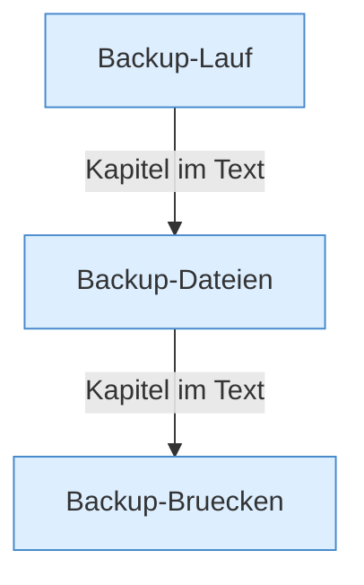

[[00 Start]] › [[Backup]]

# Backup



```knoten
Backup-Lauf
  Ein Durchlauf, der die [[Glossar#Sicherungskopie|Sicherungskopie]] packt und ablegt.
Backup-Dateien
  Wie die [[Glossar#Sicherungskopie|Sicherungskopie]] heißt, wo sie liegt, und wie viele alte Kopien behalten werden.
Backup-Bruecken
  Die beiden Wege für die [[Glossar#Sicherungskopie|Sicherungskopie]]: auf diesem Rechner, oder über das Netz. Dazu Zugangsdaten und Optionen.
```

> [!knoten] Was die Blöcke tun
> - **Backup-Lauf**: Ein Durchlauf, der die [[Glossar#Sicherungskopie|Sicherungskopie]] packt und ablegt.
> - **Backup-Dateien**: Wie die [[Glossar#Sicherungskopie|Sicherungskopie]] heißt, wo sie liegt, und wie viele alte Kopien behalten werden.
> - **Backup-Bruecken**: Die beiden Wege für die [[Glossar#Sicherungskopie|Sicherungskopie]]: auf diesem Rechner, oder über das Netz. Dazu Zugangsdaten und Optionen.

- Eine [[Glossar#Sicherungskopie|Sicherungskopie]] der [[Glossar#Spielwelt|Spielwelt]], entweder auf diesem Rechner oder über das Netz auf einen anderen.
