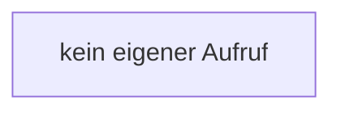

[[00 Start]] › [[Backup]] › [[Backup-Bruecken]] › [[BackupBridge]] › [[BackupBridge.Teil1]] › [[BackupBridge.BackupBridge]]

# BackupBridge.BackupBridge

`BackupBridge.BackupBridge()` [src/main/java/de/aichele/childlauncher/BackupBridge.java:41–41](https://github.com/Sciddie/minecraft-serverhoster-plugin/blob/95b02b953b0b4c23673e900e021a7c3c844aa37d/src/main/java/de/aichele/childlauncher/BackupBridge.java#L41-L41)



```knoten
kein eigener Aufruf
  In diesem Stück gibt es keinen weiteren eigenen Aufruf.
```

> [!knoten]- Was die Blöcke tun
> - **kein eigener Aufruf**: In diesem Stück gibt es keinen weiteren eigenen Aufruf.

- Die Sicherung auf diesem Rechner sichert hier einen Schritt. Eine Ebene tiefer steht er genauer.
- `BackupBridge` in `src/main/java/de/aichele/childlauncher/BackupBridge.java`
