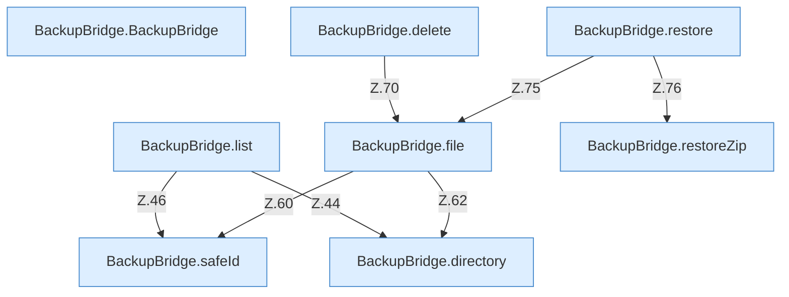

[[00 Start]] › [[Backup]] › [[Backup-Bruecken]] › [[BackupBridge]] › [[BackupBridge.Teil1]]

# BackupBridge.Teil1



```knoten
BackupBridge.BackupBridge
  Die Sicherung auf diesem Rechner sichert hier einen Schritt. Eine Ebene tiefer steht er genauer. Sichert `BackupBridge`.
BackupBridge.list
  Die Sicherung auf diesem Rechner zeigt das. Listet `list`. Ruft `directory`, `safeId`, `named`.
BackupBridge.file
  Die Sicherung auf diesem Rechner macht hier einen einzelnen Schritt. Eine Ebene tiefer steht er genauer. Liefert die Datei `file`. Ruft `safeId`, `named`, `directory`.
BackupBridge.delete
  Die Sicherung auf diesem Rechner löscht das. Löscht `delete`. Ruft `file`.
BackupBridge.restore
  Die Sicherung auf diesem Rechner stellt wieder her das. Stellt wieder her `restore`. Ruft `file`, `restoreZip`.
BackupBridge.restoreZip
  Die Sicherung auf diesem Rechner stellt wieder her hier einen Schritt. Eine Ebene tiefer steht er genauer. Stellt wieder her `restoreZip`. Ruft `open`, `resolve`.
BackupBridge.directory
  Die Sicherung auf diesem Rechner macht hier einen einzelnen Schritt. Eine Ebene tiefer steht er genauer. `directory` in `BackupBridge.java`.
BackupBridge.safeId
  Die Sicherung auf diesem Rechner kümmert sich um die Kennung. Prüft die Pfadgrenze `safeId`.
```

> [!knoten]- Was die Blöcke tun
> - **BackupBridge.BackupBridge**: Die Sicherung auf diesem Rechner sichert hier einen Schritt. Eine Ebene tiefer steht er genauer. Sichert `BackupBridge`.
> - **BackupBridge.list**: Die Sicherung auf diesem Rechner zeigt das. Listet `list`. Ruft `directory`, `safeId`, `named`.
> - **BackupBridge.file**: Die Sicherung auf diesem Rechner macht hier einen einzelnen Schritt. Eine Ebene tiefer steht er genauer. Liefert die Datei `file`. Ruft `safeId`, `named`, `directory`.
> - **BackupBridge.delete**: Die Sicherung auf diesem Rechner löscht das. Löscht `delete`. Ruft `file`.
> - **BackupBridge.restore**: Die Sicherung auf diesem Rechner stellt wieder her das. Stellt wieder her `restore`. Ruft `file`, `restoreZip`.
> - **BackupBridge.restoreZip**: Die Sicherung auf diesem Rechner stellt wieder her hier einen Schritt. Eine Ebene tiefer steht er genauer. Stellt wieder her `restoreZip`. Ruft `open`, `resolve`.
> - **BackupBridge.directory**: Die Sicherung auf diesem Rechner macht hier einen einzelnen Schritt. Eine Ebene tiefer steht er genauer. `directory` in `BackupBridge.java`.
> - **BackupBridge.safeId**: Die Sicherung auf diesem Rechner kümmert sich um die Kennung. Prüft die Pfadgrenze `safeId`.

- Ein weiterer Abschnitt derselben Übersicht.
