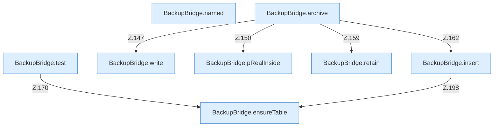

[[00 Start]] › [[Backup]] › [[Backup-Bruecken]] › [[BackupBridge]] › [[BackupBridge.Teil2]]

# BackupBridge.Teil2



```knoten
BackupBridge.named
  Die Sicherung auf diesem Rechner macht hier einen einzelnen Schritt. Eine Ebene tiefer steht er genauer. `named` in `BackupBridge.java`.
BackupBridge.archive
  Die Sicherung auf diesem Rechner macht hier einen einzelnen Schritt. Eine Ebene tiefer steht er genauer. Packt `archive`. Ruft `open`, `safeId`, `resolve`.
BackupBridge.test
  Die Sicherung auf diesem Rechner prüft das. Prüft `test`. Ruft `connect`, `ensureTable`, `table`.
BackupBridge.write
  Die Sicherung auf diesem Rechner schreibt das. Schreibt `write`.
BackupBridge.pRealInside
  Die Sicherung auf diesem Rechner macht hier einen einzelnen Schritt. Eine Ebene tiefer steht er genauer. `pRealInside` in `BackupBridge.java`. Ruft `root`.
BackupBridge.retain
  Die Sicherung auf diesem Rechner macht hier einen einzelnen Schritt. Eine Ebene tiefer steht er genauer. Behält die letzten Stücke `retain`.
BackupBridge.insert
  Die Sicherung auf diesem Rechner macht hier einen einzelnen Schritt. Eine Ebene tiefer steht er genauer. Fügt ein `insert`. Ruft `connect`, `table`, `ensureTable`.
BackupBridge.ensureTable
  Die Sicherung auf diesem Rechner macht hier einen einzelnen Schritt. Eine Ebene tiefer steht er genauer. Stellt sicher `ensureTable`.
```

> [!knoten]- Was die Blöcke tun
> - **BackupBridge.named**: Die Sicherung auf diesem Rechner macht hier einen einzelnen Schritt. Eine Ebene tiefer steht er genauer. `named` in `BackupBridge.java`.
> - **BackupBridge.archive**: Die Sicherung auf diesem Rechner macht hier einen einzelnen Schritt. Eine Ebene tiefer steht er genauer. Packt `archive`. Ruft `open`, `safeId`, `resolve`.
> - **BackupBridge.test**: Die Sicherung auf diesem Rechner prüft das. Prüft `test`. Ruft `connect`, `ensureTable`, `table`.
> - **BackupBridge.write**: Die Sicherung auf diesem Rechner schreibt das. Schreibt `write`.
> - **BackupBridge.pRealInside**: Die Sicherung auf diesem Rechner macht hier einen einzelnen Schritt. Eine Ebene tiefer steht er genauer. `pRealInside` in `BackupBridge.java`. Ruft `root`.
> - **BackupBridge.retain**: Die Sicherung auf diesem Rechner macht hier einen einzelnen Schritt. Eine Ebene tiefer steht er genauer. Behält die letzten Stücke `retain`.
> - **BackupBridge.insert**: Die Sicherung auf diesem Rechner macht hier einen einzelnen Schritt. Eine Ebene tiefer steht er genauer. Fügt ein `insert`. Ruft `connect`, `table`, `ensureTable`.
> - **BackupBridge.ensureTable**: Die Sicherung auf diesem Rechner macht hier einen einzelnen Schritt. Eine Ebene tiefer steht er genauer. Stellt sicher `ensureTable`.

- Ein weiterer Abschnitt derselben Übersicht.
