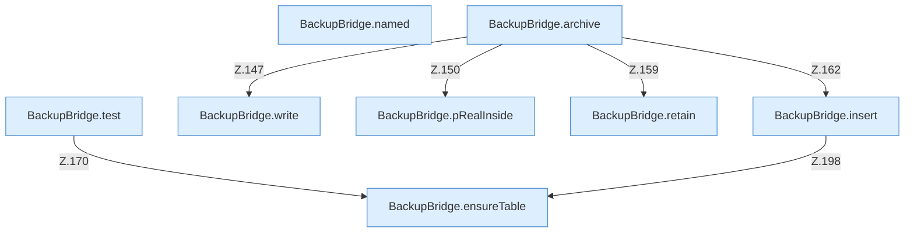

[[00 Start]] › [[Backup]] › [[Backup-Bruecken]] › [[BackupBridge]] › [[BackupBridge.Teil2]]

# BackupBridge.Teil2



```knoten
BackupBridge.named
  `named` in `BackupBridge.java`.
BackupBridge.archive
  Packt `archive`. Ruft `open`, `safeId`, `resolve`.
BackupBridge.test
  Prüft `test`. Ruft `connect`, `ensureTable`, `table`.
BackupBridge.write
  Schreibt `write`.
BackupBridge.pRealInside
  `pRealInside` in `BackupBridge.java`. Ruft `root`.
BackupBridge.retain
  Behält die letzten Stücke `retain`.
BackupBridge.insert
  Fügt ein `insert`. Ruft `connect`, `table`, `ensureTable`.
BackupBridge.ensureTable
  Stellt sicher `ensureTable`.
```


