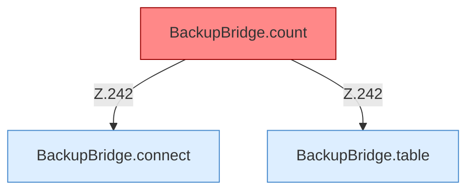

[[00 Start]] › [[Backup]] › [[Backup-Bruecken]] › [[BackupBridge]] › [[BackupBridge.Teil3]]

# BackupBridge.Teil3



```knoten
BackupBridge.table
  `table` in `BackupBridge.java`.
BackupBridge.connect
  Verbindet `connect`.
BackupBridge.count
  Zählt `count`. Ruft `connect`, `table`. Befund: toter Code (wahrscheinlich).
```


