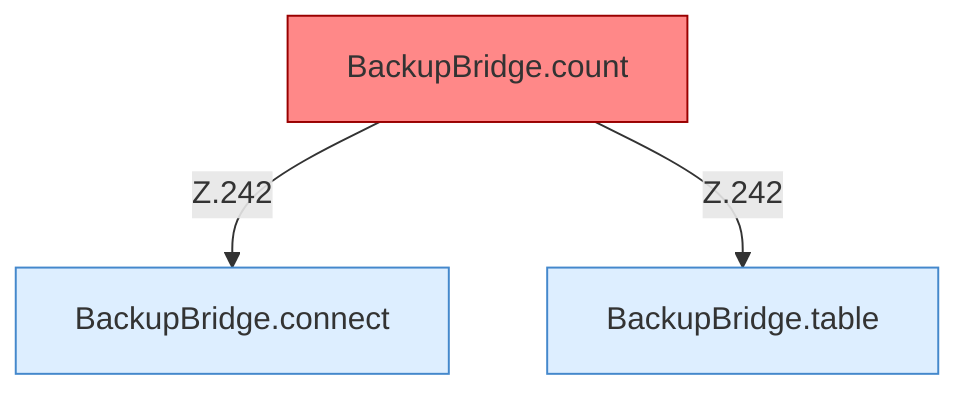

[[00 Start]] › [[Backup]] › [[Backup-Bruecken]] › [[BackupBridge]] › [[BackupBridge.Teil3]]

# BackupBridge.Teil3



```knoten
BackupBridge.table
  Die Sicherung auf diesem Rechner macht hier einen einzelnen Schritt. Eine Ebene tiefer steht er genauer. `table` in `BackupBridge.java`.
BackupBridge.connect
  Die Sicherung auf diesem Rechner macht hier einen einzelnen Schritt. Eine Ebene tiefer steht er genauer. Verbindet `connect`.
BackupBridge.count
  Die Sicherung auf diesem Rechner zählt das. Zählt `count`. Ruft `connect`, `table`. [[Glossar#Befund|Befund]]: toter Code, wahrscheinlich. src/main/java/de/aichele/childlauncher/BackupBridge.java:241–246 nur von Tests erreicht
```

> [!knoten]- Was die Blöcke tun
> - **BackupBridge.table**: Die Sicherung auf diesem Rechner macht hier einen einzelnen Schritt. Eine Ebene tiefer steht er genauer. `table` in `BackupBridge.java`.
> - **BackupBridge.connect**: Die Sicherung auf diesem Rechner macht hier einen einzelnen Schritt. Eine Ebene tiefer steht er genauer. Verbindet `connect`.
> - **BackupBridge.count**: Die Sicherung auf diesem Rechner zählt das. Zählt `count`. Ruft `connect`, `table`. [[Glossar#Befund|Befund]]: toter Code, wahrscheinlich. src/main/java/de/aichele/childlauncher/BackupBridge.java:241–246 nur von Tests erreicht

- Ein weiterer Abschnitt derselben Übersicht.
