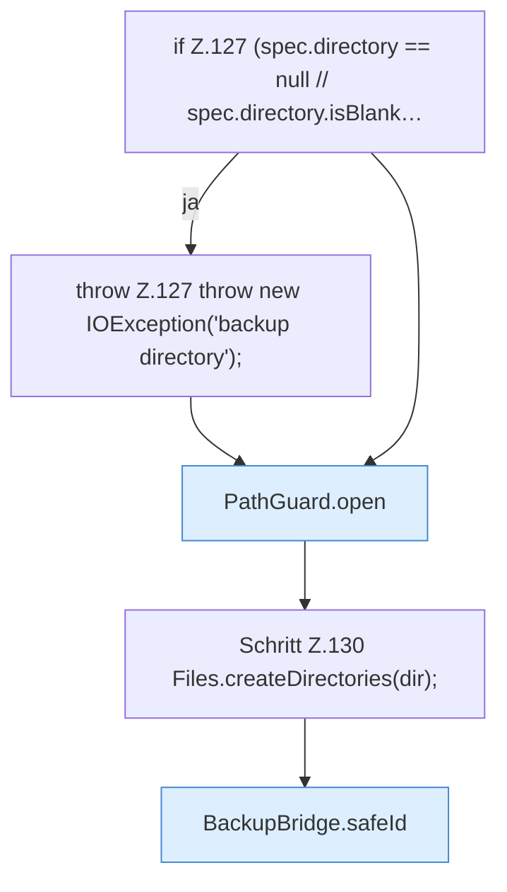

[[00 Start]] › [[Backup]] › [[Backup-Bruecken]] › [[BackupBridge]] › [[BackupBridge.Teil2]] › [[BackupBridge.archive]] › [[BackupBridge.archive.Teil1]]

# BackupBridge.archive.Teil1

- Fortsetzung von `BackupBridge.archive`, Quellreihenfolge.
