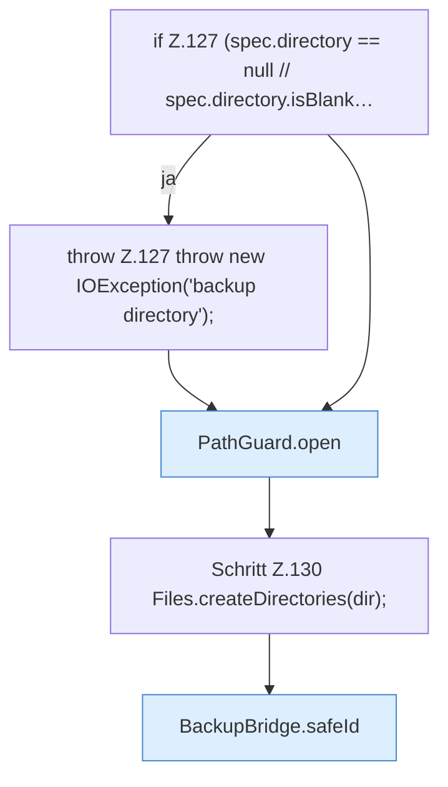

[[00 Start]] › [[Backup]] › [[Backup-Bruecken]] › [[BackupBridge]] › [[BackupBridge.Teil2]] › [[BackupBridge.archive]] › [[BackupBridge.archive.Teil1]]

# BackupBridge.archive.Teil1



```knoten
if Z.127 (spec.directory == null // spec.directory.isBlank…
  Zeile 127: prüft `(spec.directory == null // spec.directory.isBlank…`.
throw Z.127 throw new IOException('backup directory');
  Zeile 127: Abbruch `throw new IOException('backup directory');`.
PathGuard.open
  Öffnet `open`. Ruft `PathGuard`.
Schritt Z.130 Files.createDirectories(dir);
  Zeile 130: Dateioperation. `Files.createDirectories(dir);`
BackupBridge.safeId
  Prüft die Pfadgrenze `safeId`.
```

- Fortsetzung von `BackupBridge.archive`, Quellreihenfolge.
