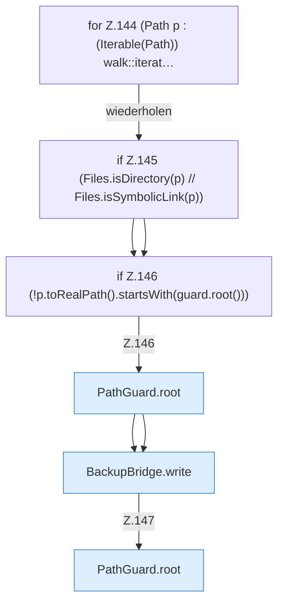

[[00 Start]] › [[Backup]] › [[Backup-Bruecken]] › [[BackupBridge]] › [[BackupBridge.Teil2]] › [[BackupBridge.archive]] › [[BackupBridge.archive.Teil2.Z136.Z138.Z142.Z143.Z144]]

# BackupBridge.archive.Teil2.Z136.Z138.Z142.Z143.Z144



```knoten
for Z.144 (Path p : (Iterable(Path)) walk::iterat…
  Zeile 144: Schleife `(Path p : (Iterable(Path)) walk::iterat…`.
if Z.145 (Files.isDirectory(p) // Files.isSymbolicLink(p))
  Zeile 145: prüft `(Files.isDirectory(p) // Files.isSymbolicLink(p))`.
if Z.146 (!p.toRealPath().startsWith(guard.root()))
  Zeile 146: prüft `(!p.toRealPath().startsWith(guard.root()))`.
PathGuard.root
  Dieser Teil macht hier einen einzelnen Schritt. Eine Ebene tiefer steht er genauer. Liefert die Wurzel `root`.
BackupBridge.write
  Die Sicherung auf diesem Rechner schreibt das. Schreibt `write`.
```

> [!knoten]- Was die Blöcke tun
> - **for Z.144 (Path p : (Iterable(Path)) walk::iterat…**: Zeile 144: Schleife `(Path p : (Iterable(Path)) walk::iterat…`.
> - **if Z.145 (Files.isDirectory(p) // Files.isSymbolicLink(p))**: Zeile 145: prüft `(Files.isDirectory(p) // Files.isSymbolicLink(p))`.
> - **if Z.146 (!p.toRealPath().startsWith(guard.root()))**: Zeile 146: prüft `(!p.toRealPath().startsWith(guard.root()))`.
> - **PathGuard.root**: Dieser Teil macht hier einen einzelnen Schritt. Eine Ebene tiefer steht er genauer. Liefert die Wurzel `root`.
> - **BackupBridge.write**: Die Sicherung auf diesem Rechner schreibt das. Schreibt `write`.

- Der Ablauf geht in [[Glossar#Zeile|Zeile]] 144 weiter. Eine Ebene tiefer steht er genauer.
- Fortsetzung von `BackupBridge.archive.Teil2.Z136.Z138.Z142.Z143`.
