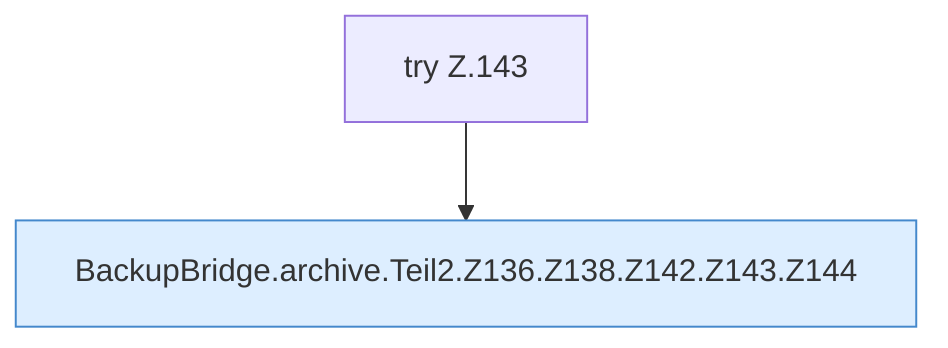

[[00 Start]] › [[Backup]] › [[Backup-Bruecken]] › [[BackupBridge]] › [[BackupBridge.Teil2]] › [[BackupBridge.archive]] › [[BackupBridge.archive.Teil2.Z136.Z138.Z142.Z143]]

# BackupBridge.archive.Teil2.Z136.Z138.Z142.Z143



```knoten
try Z.143
  Zeile 143: Versuch. Der Fehlerpfad geht in catch.
BackupBridge.archive.Teil2.Z136.Z138.Z142.Z143.Z144
  Der Ablauf geht in [[Glossar#Zeile|Zeile]] 144 weiter. Eine Ebene tiefer steht er genauer. Fortsetzung des Ablaufs ab Zeile 144.
```

> [!knoten]- Was die Blöcke tun
> - **try Z.143**: Zeile 143: Versuch. Der Fehlerpfad geht in catch.
> - **BackupBridge.archive.Teil2.Z136.Z138.Z142.Z143.Z144**: Der Ablauf geht in [[Glossar#Zeile|Zeile]] 144 weiter. Eine Ebene tiefer steht er genauer. Fortsetzung des Ablaufs ab Zeile 144.

- Der Ablauf geht in [[Glossar#Zeile|Zeile]] 143 weiter. Eine Ebene tiefer steht er genauer.
- Fortsetzung von `BackupBridge.archive.Teil2.Z136.Z138.Z142`.
