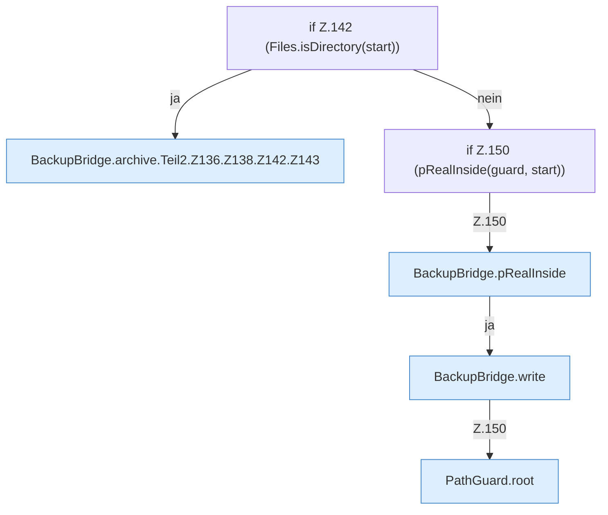

[[00 Start]] › [[Backup]] › [[Backup-Bruecken]] › [[BackupBridge]] › [[BackupBridge.Teil2]] › [[BackupBridge.archive]] › [[BackupBridge.archive.Teil2.Z136.Z138.Z142]]

# BackupBridge.archive.Teil2.Z136.Z138.Z142

- Fortsetzung von `BackupBridge.archive.Teil2.Z136.Z138`, Quellreihenfolge.
