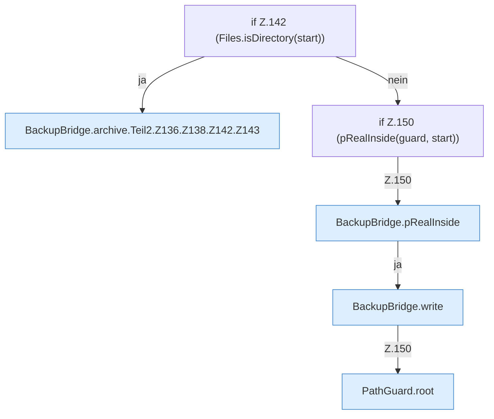

[[00 Start]] › [[Backup]] › [[Backup-Bruecken]] › [[BackupBridge]] › [[BackupBridge.Teil2]] › [[BackupBridge.archive]] › [[BackupBridge.archive.Teil2.Z136.Z138.Z142]]

# BackupBridge.archive.Teil2.Z136.Z138.Z142



```knoten
if Z.142 (Files.isDirectory(start))
  Zeile 142: prüft `(Files.isDirectory(start))`.
BackupBridge.archive.Teil2.Z136.Z138.Z142.Z143
  Der Ablauf geht in [[Glossar#Zeile|Zeile]] 143 weiter. Eine Ebene tiefer steht er genauer. Fortsetzung des Ablaufs ab Zeile 143.
if Z.150 (pRealInside(guard, start))
  Zeile 150: prüft `(pRealInside(guard, start))`.
BackupBridge.pRealInside
  Die Sicherung auf diesem Rechner macht hier einen einzelnen Schritt. Eine Ebene tiefer steht er genauer. `pRealInside` in `BackupBridge.java`. Ruft `root`.
BackupBridge.write
  Die Sicherung auf diesem Rechner schreibt das. Schreibt `write`.
PathGuard.root
  Dieser Teil macht hier einen einzelnen Schritt. Eine Ebene tiefer steht er genauer. Liefert die Wurzel `root`.
```

> [!knoten]- Was die Blöcke tun
> - **if Z.142 (Files.isDirectory(start))**: Zeile 142: prüft `(Files.isDirectory(start))`.
> - **BackupBridge.archive.Teil2.Z136.Z138.Z142.Z143**: Der Ablauf geht in [[Glossar#Zeile|Zeile]] 143 weiter. Eine Ebene tiefer steht er genauer. Fortsetzung des Ablaufs ab Zeile 143.
> - **if Z.150 (pRealInside(guard, start))**: Zeile 150: prüft `(pRealInside(guard, start))`.
> - **BackupBridge.pRealInside**: Die Sicherung auf diesem Rechner macht hier einen einzelnen Schritt. Eine Ebene tiefer steht er genauer. `pRealInside` in `BackupBridge.java`. Ruft `root`.
> - **BackupBridge.write**: Die Sicherung auf diesem Rechner schreibt das. Schreibt `write`.
> - **PathGuard.root**: Dieser Teil macht hier einen einzelnen Schritt. Eine Ebene tiefer steht er genauer. Liefert die Wurzel `root`.

- Der Ablauf geht in [[Glossar#Zeile|Zeile]] 142 weiter. Eine Ebene tiefer steht er genauer.
- Fortsetzung von `BackupBridge.archive.Teil2.Z136.Z138`.
