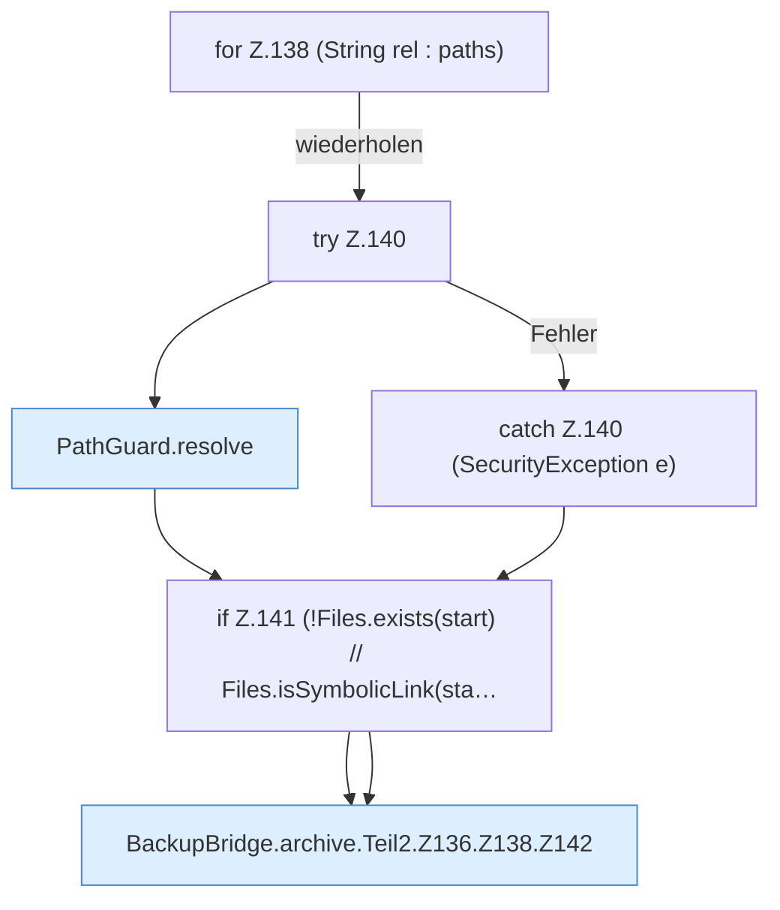

[[00 Start]] › [[Backup]] › [[Backup-Bruecken]] › [[BackupBridge]] › [[BackupBridge.Teil2]] › [[BackupBridge.archive]] › [[BackupBridge.archive.Teil2.Z136.Z138]]

# BackupBridge.archive.Teil2.Z136.Z138



```knoten
for Z.138 (String rel : paths)
  Zeile 138: Schleife `(String rel : paths)`.
try Z.140
  Zeile 140: Versuch. Der Fehlerpfad geht in catch.
PathGuard.resolve
  Löst auf `resolve`.
catch Z.140 (SecurityException e)
  Zeile 140: fängt (SecurityException e).
if Z.141 (!Files.exists(start) // Files.isSymbolicLink(sta…
  Zeile 141: prüft `(!Files.exists(start) // Files.isSymbolicLink(sta…`.
BackupBridge.archive.Teil2.Z136.Z138.Z142
  Fortsetzung des Ablaufs ab Zeile 142.
```

- Fortsetzung von `BackupBridge.archive.Teil2.Z136`, Quellreihenfolge.
