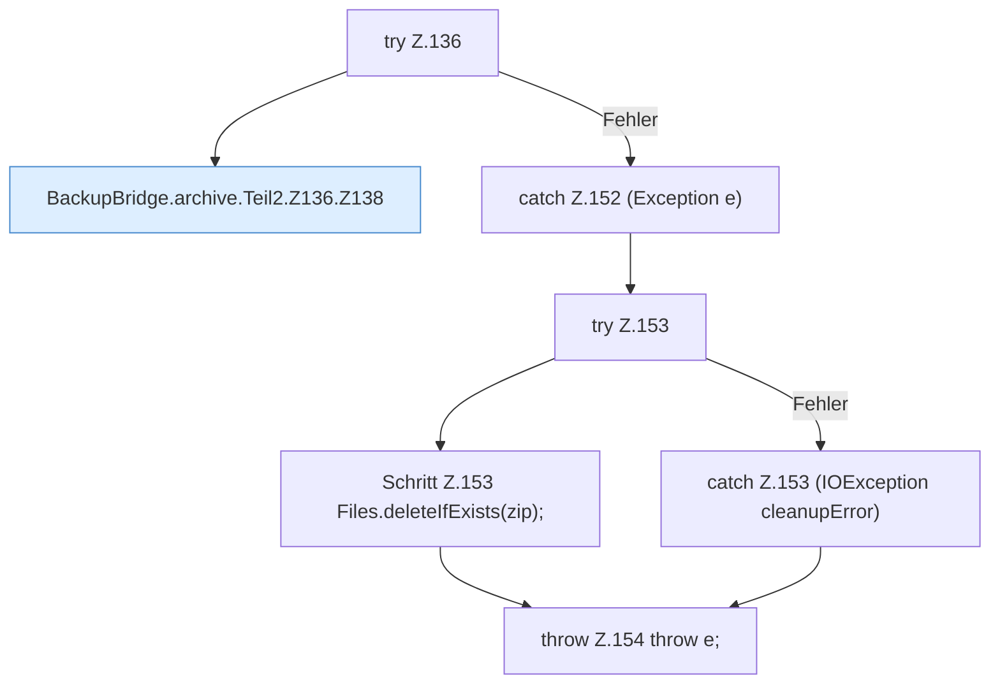

[[00 Start]] › [[Backup]] › [[Backup-Bruecken]] › [[BackupBridge]] › [[BackupBridge.Teil2]] › [[BackupBridge.archive]] › [[BackupBridge.archive.Teil2.Z136]]

# BackupBridge.archive.Teil2.Z136



```knoten
try Z.136
  Zeile 136: Versuch. Der Fehlerpfad geht in catch.
BackupBridge.archive.Teil2.Z136.Z138
  Der Ablauf geht in [[Glossar#Zeile|Zeile]] 138 weiter. Eine Ebene tiefer steht er genauer. Fortsetzung des Ablaufs ab Zeile 138.
catch Z.152 (Exception e)
  Zeile 152: fängt (Exception e).
try Z.153
  Zeile 153: Versuch. Der Fehlerpfad geht in catch.
Schritt Z.153 Files.deleteIfExists(zip);
  Zeile 153: Dateioperation. `Files.deleteIfExists(zip);`
catch Z.153 (IOException cleanupError)
  Zeile 153: fängt (IOException cleanupError).
throw Z.154 throw e;
  Zeile 154: Abbruch `throw e;`.
```

> [!knoten]- Was die Blöcke tun
> - **try Z.136**: Zeile 136: Versuch. Der Fehlerpfad geht in catch.
> - **BackupBridge.archive.Teil2.Z136.Z138**: Der Ablauf geht in [[Glossar#Zeile|Zeile]] 138 weiter. Eine Ebene tiefer steht er genauer. Fortsetzung des Ablaufs ab Zeile 138.
> - **catch Z.152 (Exception e)**: Zeile 152: fängt (Exception e).
> - **try Z.153**: Zeile 153: Versuch. Der Fehlerpfad geht in catch.
> - **Schritt Z.153 Files.deleteIfExists(zip);**: Zeile 153: Dateioperation. `Files.deleteIfExists(zip);`
> - **catch Z.153 (IOException cleanupError)**: Zeile 153: fängt (IOException cleanupError).
> - **throw Z.154 throw e;**: Zeile 154: Abbruch `throw e;`.

- Der Ablauf geht in [[Glossar#Zeile|Zeile]] 136 weiter. Eine Ebene tiefer steht er genauer.
- Fortsetzung von `BackupBridge.archive.Teil2`.
