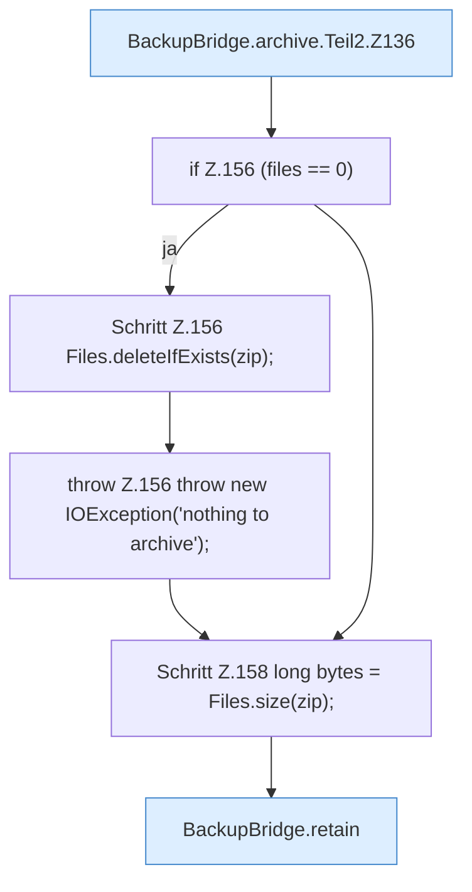

[[00 Start]] › [[Backup]] › [[Backup-Bruecken]] › [[BackupBridge]] › [[BackupBridge.Teil2]] › [[BackupBridge.archive]] › [[BackupBridge.archive.Teil2]]

# BackupBridge.archive.Teil2



```knoten
BackupBridge.archive.Teil2.Z136
  Fortsetzung des Ablaufs ab Zeile 136.
if Z.156 (files == 0)
  Zeile 156: prüft `(files == 0)`.
Schritt Z.156 Files.deleteIfExists(zip);
  Zeile 156: Dateioperation. `Files.deleteIfExists(zip);`
throw Z.156 throw new IOException('nothing to archive');
  Zeile 156: Abbruch `throw new IOException('nothing to archive');`.
Schritt Z.158 long bytes = Files.size(zip);
  Zeile 158: Dateioperation. `long bytes = Files.size(zip);`
BackupBridge.retain
  Behält die letzten Stücke `retain`.
```

- Fortsetzung von `BackupBridge.archive`, Quellreihenfolge.
