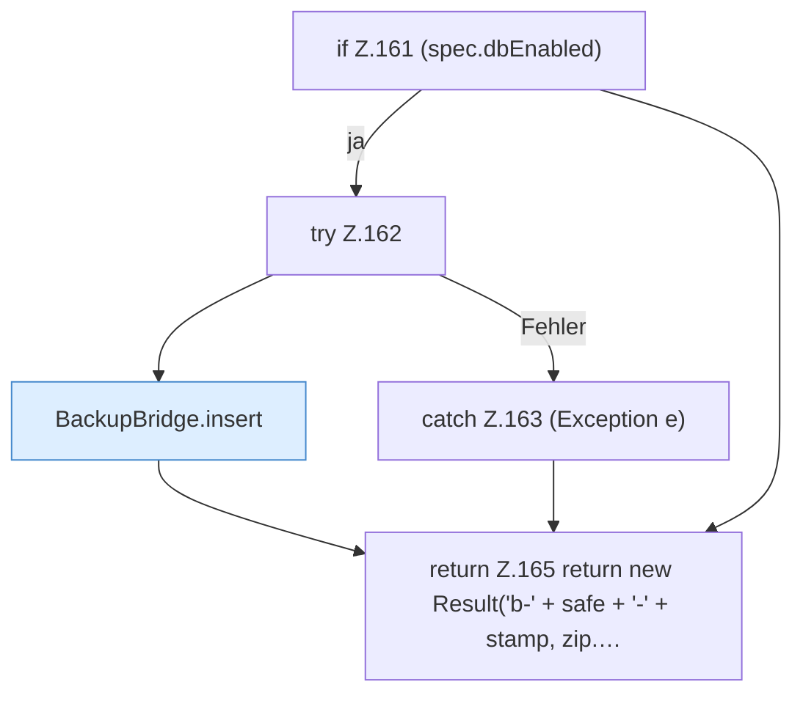

[[00 Start]] › [[Backup]] › [[Backup-Bruecken]] › [[BackupBridge]] › [[BackupBridge.Teil2]] › [[BackupBridge.archive]] › [[BackupBridge.archive.Teil3]]

# BackupBridge.archive.Teil3



```knoten
if Z.161 (spec.dbEnabled)
  Zeile 161: prüft `(spec.dbEnabled)`.
try Z.162
  Zeile 162: Versuch. Der Fehlerpfad geht in catch.
BackupBridge.insert
  Die Sicherung auf diesem Rechner macht hier einen einzelnen Schritt. Eine Ebene tiefer steht er genauer. Fügt ein `insert`. Ruft `connect`, `table`, `ensureTable`.
catch Z.163 (Exception e)
  Zeile 163: fängt (Exception e).
return Z.165 return new Result('b-' + safe + '-' + stamp, zip.…
  Zeile 165: Rückgabe `return new Result('b-' + safe + '-' + stamp, zip.…`.
```

> [!knoten]- Was die Blöcke tun
> - **if Z.161 (spec.dbEnabled)**: Zeile 161: prüft `(spec.dbEnabled)`.
> - **try Z.162**: Zeile 162: Versuch. Der Fehlerpfad geht in catch.
> - **BackupBridge.insert**: Die Sicherung auf diesem Rechner macht hier einen einzelnen Schritt. Eine Ebene tiefer steht er genauer. Fügt ein `insert`. Ruft `connect`, `table`, `ensureTable`.
> - **catch Z.163 (Exception e)**: Zeile 163: fängt (Exception e).
> - **return Z.165 return new Result('b-' + safe + '-' + stamp, zip.…**: Zeile 165: Rückgabe `return new Result('b-' + safe + '-' + stamp, zip.…`.

- Ein weiterer Abschnitt derselben Übersicht.
- Fortsetzung von `BackupBridge.archive`.
