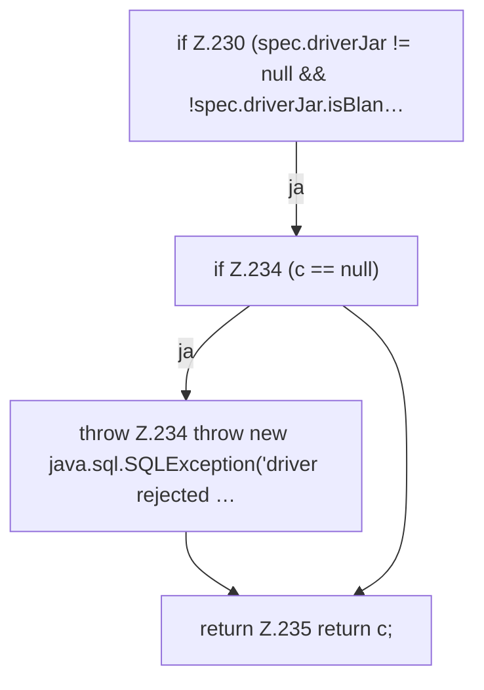

[[00 Start]] › [[Backup]] › [[Backup-Bruecken]] › [[BackupBridge]] › [[BackupBridge.Teil3]] › [[BackupBridge.connect]] › [[BackupBridge.connect.Z230]]

# BackupBridge.connect.Z230



```knoten
if Z.230 (spec.driverJar != null && !spec.driverJar.isBlan…
  Zeile 230: prüft `(spec.driverJar != null && !spec.driverJar.isBlan…`.
if Z.234 (c == null)
  Zeile 234: prüft `(c == null)`.
throw Z.234 throw new java.sql.SQLException('driver rejected …
  Zeile 234: Abbruch `throw new java.sql.SQLException('driver rejected …`.
return Z.235 return c;
  Zeile 235: Rückgabe `return c;`.
```

> [!knoten]- Was die Blöcke tun
> - **if Z.230 (spec.driverJar != null && !spec.driverJar.isBlan…**: Zeile 230: prüft `(spec.driverJar != null && !spec.driverJar.isBlan…`.
> - **if Z.234 (c == null)**: Zeile 234: prüft `(c == null)`.
> - **throw Z.234 throw new java.sql.SQLException('driver rejected …**: Zeile 234: Abbruch `throw new java.sql.SQLException('driver rejected …`.
> - **return Z.235 return c;**: Zeile 235: Rückgabe `return c;`.

- Der Ablauf geht in [[Glossar#Zeile|Zeile]] 230 weiter. Eine Ebene tiefer steht er genauer.
- Fortsetzung von `BackupBridge.connect`.
