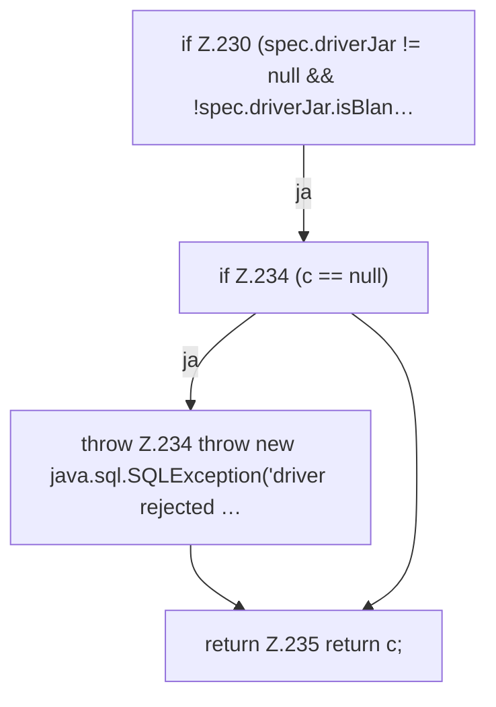

[[00 Start]] › [[Backup]] › [[Backup-Bruecken]] › [[BackupBridge]] › [[BackupBridge.Teil3]] › [[BackupBridge.connect]] › [[BackupBridge.connect.Z230]]

# BackupBridge.connect.Z230

- Fortsetzung von `BackupBridge.connect`, Quellreihenfolge.
