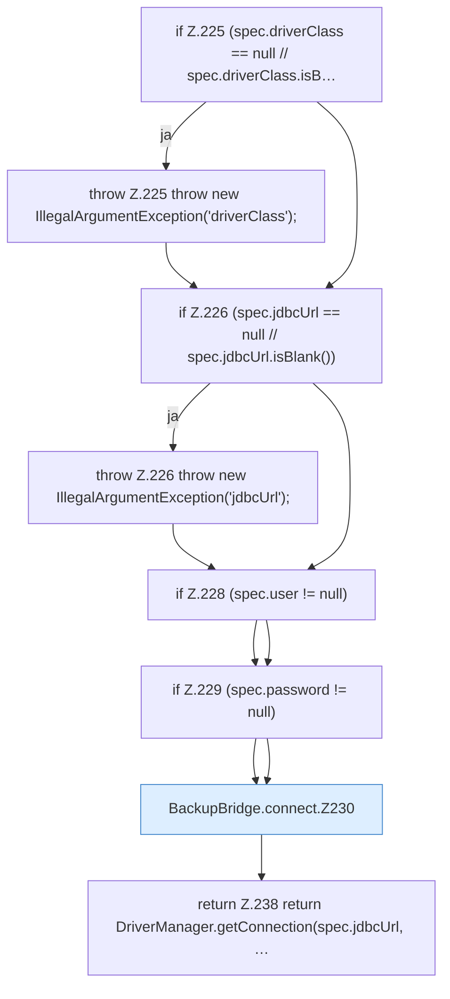

[[00 Start]] › [[Backup]] › [[Backup-Bruecken]] › [[BackupBridge]] › [[BackupBridge.Teil3]] › [[BackupBridge.connect]]

# BackupBridge.connect

`BackupBridge.connect(Spec spec)` [src/main/java/de/aichele/childlauncher/BackupBridge.java:224–239](https://github.com/Sciddie/minecraft-serverhoster-plugin/blob/95b02b953b0b4c23673e900e021a7c3c844aa37d/src/main/java/de/aichele/childlauncher/BackupBridge.java#L224-L239)



```knoten
if Z.225 (spec.driverClass == null // spec.driverClass.isB…
  Zeile 225: prüft `(spec.driverClass == null // spec.driverClass.isB…`.
throw Z.225 throw new IllegalArgumentException('driverClass');
  Zeile 225: Abbruch `throw new IllegalArgumentException('driverClass');`.
if Z.226 (spec.jdbcUrl == null // spec.jdbcUrl.isBlank())
  Zeile 226: prüft `(spec.jdbcUrl == null // spec.jdbcUrl.isBlank())`.
throw Z.226 throw new IllegalArgumentException('jdbcUrl');
  Zeile 226: Abbruch `throw new IllegalArgumentException('jdbcUrl');`.
if Z.228 (spec.user != null)
  Zeile 228: prüft `(spec.user != null)`.
if Z.229 (spec.password != null)
  Zeile 229: prüft `(spec.password != null)`.
BackupBridge.connect.Z230
  Fortsetzung des Ablaufs ab Zeile 230.
return Z.238 return DriverManager.getConnection(spec.jdbcUrl, …
  Zeile 238: Rückgabe `return DriverManager.getConnection(spec.jdbcUrl, …`.
```

- `connect` in `src/main/java/de/aichele/childlauncher/BackupBridge.java`
