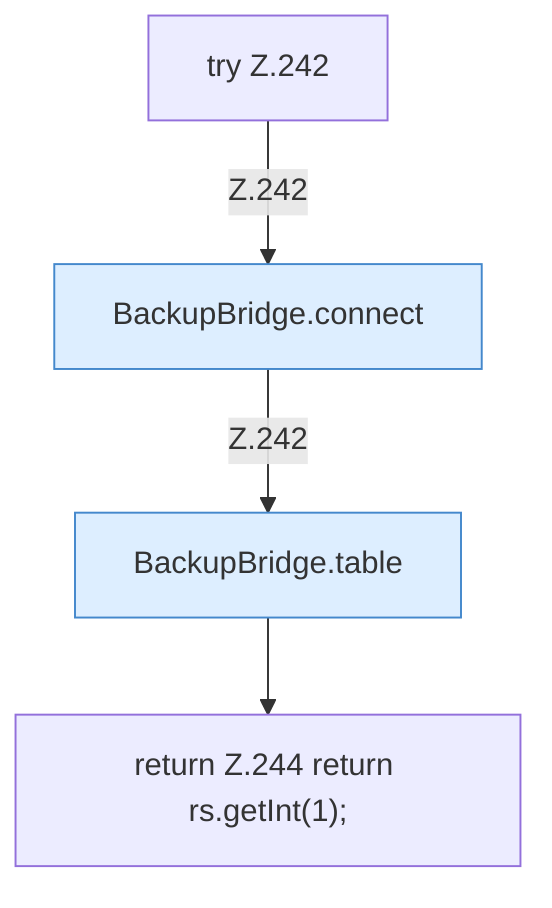

[[00 Start]] › [[Backup]] › [[Backup-Bruecken]] › [[BackupBridge]] › [[BackupBridge.Teil3]] › [[BackupBridge.count]]

# BackupBridge.count

`BackupBridge.count(Spec spec)` [src/main/java/de/aichele/childlauncher/BackupBridge.java:241–246](https://github.com/Sciddie/minecraft-serverhoster-plugin/blob/95b02b953b0b4c23673e900e021a7c3c844aa37d/src/main/java/de/aichele/childlauncher/BackupBridge.java#L241-L246)



```knoten
try Z.242
  Zeile 242: Versuch. Der Fehlerpfad geht in catch.
BackupBridge.connect
  Die Sicherung auf diesem Rechner macht hier einen einzelnen Schritt. Eine Ebene tiefer steht er genauer. Verbindet `connect`.
BackupBridge.table
  Die Sicherung auf diesem Rechner macht hier einen einzelnen Schritt. Eine Ebene tiefer steht er genauer. `table` in `BackupBridge.java`.
return Z.244 return rs.getInt(1);
  Zeile 244: Rückgabe `return rs.getInt(1);`.
```

> [!knoten]- Was die Blöcke tun
> - **try Z.242**: Zeile 242: Versuch. Der Fehlerpfad geht in catch.
> - **BackupBridge.connect**: Die Sicherung auf diesem Rechner macht hier einen einzelnen Schritt. Eine Ebene tiefer steht er genauer. Verbindet `connect`.
> - **BackupBridge.table**: Die Sicherung auf diesem Rechner macht hier einen einzelnen Schritt. Eine Ebene tiefer steht er genauer. `table` in `BackupBridge.java`.
> - **return Z.244 return rs.getInt(1);**: Zeile 244: Rückgabe `return rs.getInt(1);`.

- Die Sicherung auf diesem Rechner zählt das.
- `count` in `src/main/java/de/aichele/childlauncher/BackupBridge.java`
- Befund: toter Code, wahrscheinlich. src/main/java/de/aichele/childlauncher/BackupBridge.java:241–246 nur von Tests erreicht
