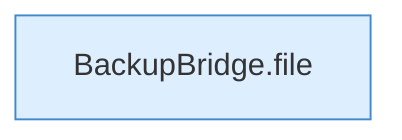

[[00 Start]] › [[Backup]] › [[Backup-Bruecken]] › [[BackupBridge]] › [[BackupBridge.Teil1]] › [[BackupBridge.delete]]

# BackupBridge.delete

`BackupBridge.delete(Spec spec, String serverId, String name)` [src/main/java/de/aichele/childlauncher/BackupBridge.java:69–71](https://github.com/Sciddie/minecraft-serverhoster-plugin/blob/95b02b953b0b4c23673e900e021a7c3c844aa37d/src/main/java/de/aichele/childlauncher/BackupBridge.java#L69-L71)



```knoten
BackupBridge.file
  Liefert die Datei `file`. Ruft `safeId`, `named`, `directory`.
```

- `delete` in `src/main/java/de/aichele/childlauncher/BackupBridge.java`
