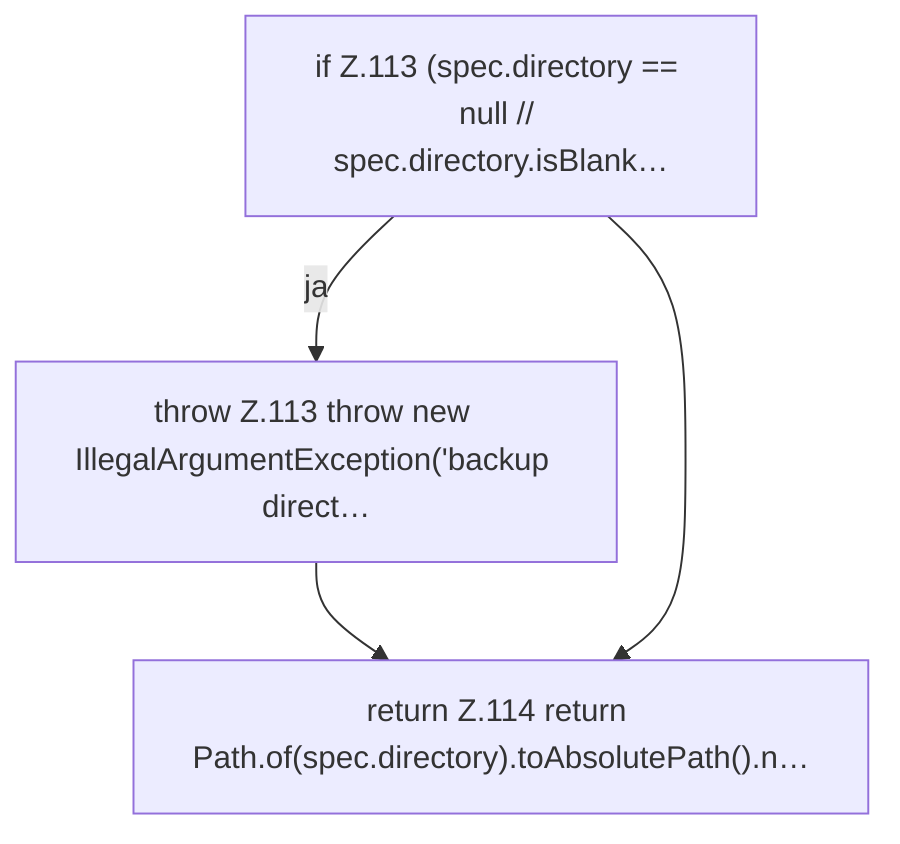

[[00 Start]] › [[Backup]] › [[Backup-Bruecken]] › [[BackupBridge]] › [[BackupBridge.Teil1]] › [[BackupBridge.directory]]

# BackupBridge.directory

`BackupBridge.directory(Spec spec)` [src/main/java/de/aichele/childlauncher/BackupBridge.java:112–115](https://github.com/Sciddie/minecraft-serverhoster-plugin/blob/95b02b953b0b4c23673e900e021a7c3c844aa37d/src/main/java/de/aichele/childlauncher/BackupBridge.java#L112-L115)



```knoten
if Z.113 (spec.directory == null // spec.directory.isBlank…
  Zeile 113: prüft `(spec.directory == null // spec.directory.isBlank…`.
throw Z.113 throw new IllegalArgumentException('backup direct…
  Zeile 113: Abbruch `throw new IllegalArgumentException('backup direct…`.
return Z.114 return Path.of(spec.directory).toAbsolutePath().n…
  Zeile 114: Rückgabe `return Path.of(spec.directory).toAbsolutePath().n…`.
```

- `directory` in `src/main/java/de/aichele/childlauncher/BackupBridge.java`
