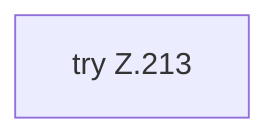

[[00 Start]] › [[Backup]] › [[Backup-Bruecken]] › [[BackupBridge]] › [[BackupBridge.Teil2]] › [[BackupBridge.ensureTable]]

# BackupBridge.ensureTable

`BackupBridge.ensureTable(Connection c, String table)` [src/main/java/de/aichele/childlauncher/BackupBridge.java:212–216](https://github.com/Sciddie/minecraft-serverhoster-plugin/blob/95b02b953b0b4c23673e900e021a7c3c844aa37d/src/main/java/de/aichele/childlauncher/BackupBridge.java#L212-L216)

- `ensureTable` in `src/main/java/de/aichele/childlauncher/BackupBridge.java`
