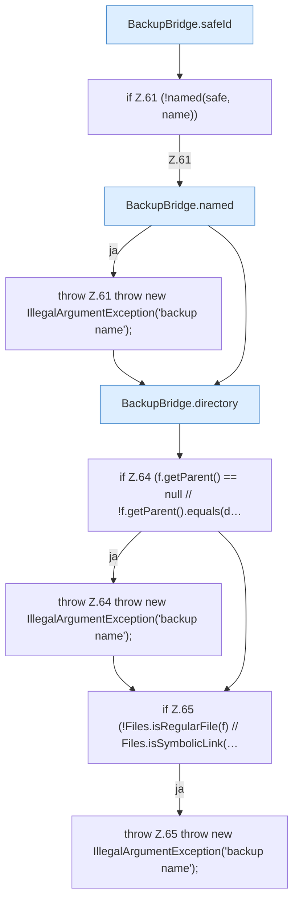

[[00 Start]] › [[Backup]] › [[Backup-Bruecken]] › [[BackupBridge]] › [[BackupBridge.Teil1]] › [[BackupBridge.file]] › [[BackupBridge.file.Teil1]]

# BackupBridge.file.Teil1

- Fortsetzung von `BackupBridge.file`, Quellreihenfolge.
