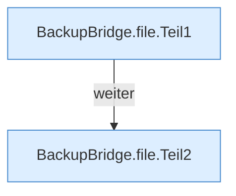

[[00 Start]] › [[Backup]] › [[Backup-Bruecken]] › [[BackupBridge]] › [[BackupBridge.Teil1]] › [[BackupBridge.file]]

# BackupBridge.file

`BackupBridge.file(Spec spec, String serverId, String name)` [src/main/java/de/aichele/childlauncher/BackupBridge.java:59–67](https://github.com/Sciddie/minecraft-serverhoster-plugin/blob/95b02b953b0b4c23673e900e021a7c3c844aa37d/src/main/java/de/aichele/childlauncher/BackupBridge.java#L59-L67)



```knoten
BackupBridge.file.Teil1
  Ein weiterer Abschnitt derselben Übersicht. Abschnitt 1 dieses Ablaufs, in Quellreihenfolge.
BackupBridge.file.Teil2
  Ein weiterer Abschnitt derselben Übersicht. Abschnitt 2 dieses Ablaufs, in Quellreihenfolge.
```

> [!knoten]- Was die Blöcke tun
> - **BackupBridge.file.Teil1**: Ein weiterer Abschnitt derselben Übersicht. Abschnitt 1 dieses Ablaufs, in Quellreihenfolge.
> - **BackupBridge.file.Teil2**: Ein weiterer Abschnitt derselben Übersicht. Abschnitt 2 dieses Ablaufs, in Quellreihenfolge.

- Die Sicherung auf diesem Rechner macht hier einen einzelnen Schritt. Eine Ebene tiefer steht er genauer.
- `file` in `src/main/java/de/aichele/childlauncher/BackupBridge.java`
