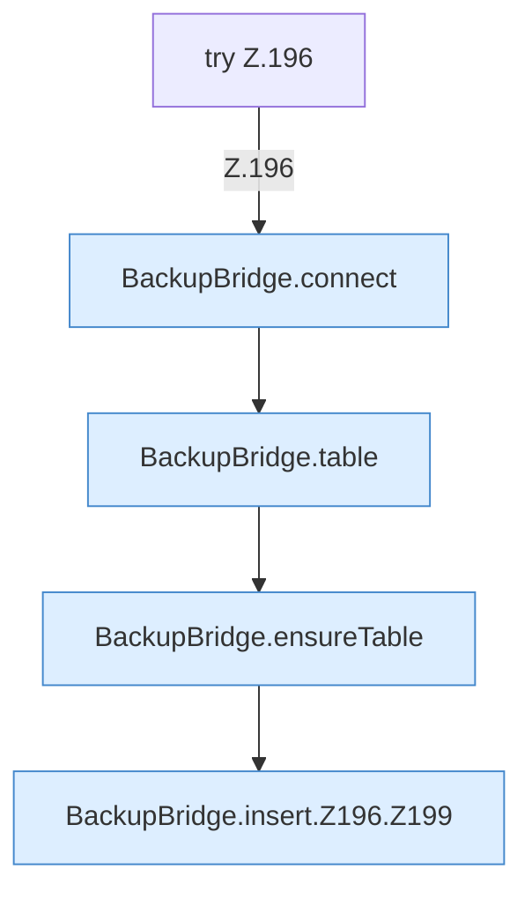

[[00 Start]] › [[Backup]] › [[Backup-Bruecken]] › [[BackupBridge]] › [[BackupBridge.Teil2]] › [[BackupBridge.insert]] › [[BackupBridge.insert.Z196]]

# BackupBridge.insert.Z196



```knoten
try Z.196
  Zeile 196: Versuch. Der Fehlerpfad geht in catch.
BackupBridge.connect
  Die Sicherung auf diesem Rechner macht hier einen einzelnen Schritt. Eine Ebene tiefer steht er genauer. Verbindet `connect`.
BackupBridge.table
  Die Sicherung auf diesem Rechner macht hier einen einzelnen Schritt. Eine Ebene tiefer steht er genauer. `table` in `BackupBridge.java`.
BackupBridge.ensureTable
  Die Sicherung auf diesem Rechner macht hier einen einzelnen Schritt. Eine Ebene tiefer steht er genauer. Stellt sicher `ensureTable`.
BackupBridge.insert.Z196.Z199
  Der Ablauf geht in [[Glossar#Zeile|Zeile]] 199 weiter. Eine Ebene tiefer steht er genauer. Fortsetzung des Ablaufs ab Zeile 199.
```

> [!knoten]- Was die Blöcke tun
> - **try Z.196**: Zeile 196: Versuch. Der Fehlerpfad geht in catch.
> - **BackupBridge.connect**: Die Sicherung auf diesem Rechner macht hier einen einzelnen Schritt. Eine Ebene tiefer steht er genauer. Verbindet `connect`.
> - **BackupBridge.table**: Die Sicherung auf diesem Rechner macht hier einen einzelnen Schritt. Eine Ebene tiefer steht er genauer. `table` in `BackupBridge.java`.
> - **BackupBridge.ensureTable**: Die Sicherung auf diesem Rechner macht hier einen einzelnen Schritt. Eine Ebene tiefer steht er genauer. Stellt sicher `ensureTable`.
> - **BackupBridge.insert.Z196.Z199**: Der Ablauf geht in [[Glossar#Zeile|Zeile]] 199 weiter. Eine Ebene tiefer steht er genauer. Fortsetzung des Ablaufs ab Zeile 199.

- Der Ablauf geht in [[Glossar#Zeile|Zeile]] 196 weiter. Eine Ebene tiefer steht er genauer.
- Fortsetzung von `BackupBridge.insert`.
