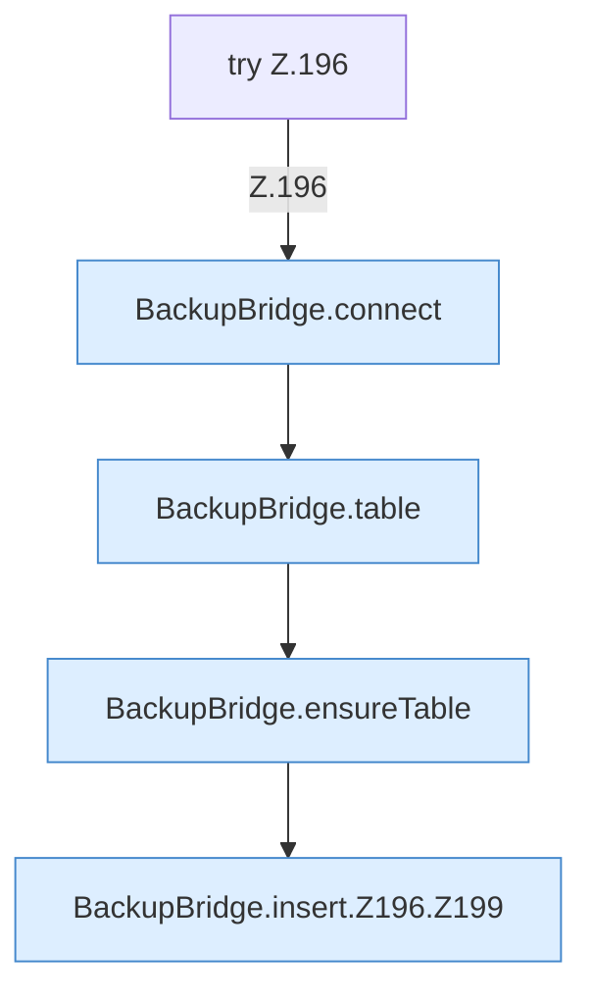

[[00 Start]] › [[Backup]] › [[Backup-Bruecken]] › [[BackupBridge]] › [[BackupBridge.Teil2]] › [[BackupBridge.insert]] › [[BackupBridge.insert.Z196]]

# BackupBridge.insert.Z196

- Fortsetzung von `BackupBridge.insert`, Quellreihenfolge.
