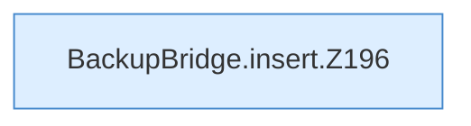

[[00 Start]] › [[Backup]] › [[Backup-Bruecken]] › [[BackupBridge]] › [[BackupBridge.Teil2]] › [[BackupBridge.insert]]

# BackupBridge.insert

`BackupBridge.insert(Spec spec, String id, String server, String path, long bytes, String sha)` [src/main/java/de/aichele/childlauncher/BackupBridge.java:195–210](https://github.com/Sciddie/minecraft-serverhoster-plugin/blob/95b02b953b0b4c23673e900e021a7c3c844aa37d/src/main/java/de/aichele/childlauncher/BackupBridge.java#L195-L210)



```knoten
BackupBridge.insert.Z196
  Der Ablauf geht in [[Glossar#Zeile|Zeile]] 196 weiter. Eine Ebene tiefer steht er genauer. Fortsetzung des Ablaufs ab Zeile 196.
```

> [!knoten]- Was die Blöcke tun
> - **BackupBridge.insert.Z196**: Der Ablauf geht in [[Glossar#Zeile|Zeile]] 196 weiter. Eine Ebene tiefer steht er genauer. Fortsetzung des Ablaufs ab Zeile 196.

- Die Sicherung auf diesem Rechner macht hier einen einzelnen Schritt. Eine Ebene tiefer steht er genauer.
- `insert` in `src/main/java/de/aichele/childlauncher/BackupBridge.java`
