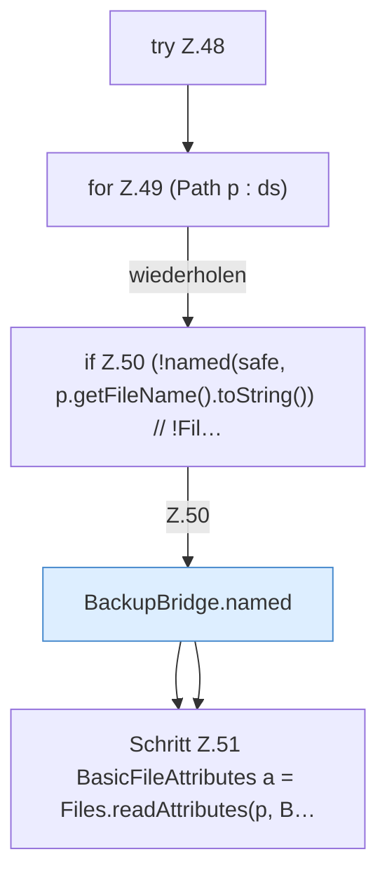

[[00 Start]] › [[Backup]] › [[Backup-Bruecken]] › [[BackupBridge]] › [[BackupBridge.Teil1]] › [[BackupBridge.list]] › [[BackupBridge.list.Z48]]

# BackupBridge.list.Z48



```knoten
try Z.48
  Zeile 48: Versuch. Der Fehlerpfad geht in catch.
for Z.49 (Path p : ds)
  Zeile 49: Schleife `(Path p : ds)`.
if Z.50 (!named(safe, p.getFileName().toString()) // !Fil…
  Zeile 50: prüft `(!named(safe, p.getFileName().toString()) // !Fil…`.
BackupBridge.named
  `named` in `BackupBridge.java`.
Schritt Z.51 BasicFileAttributes a = Files.readAttributes(p, B…
  Zeile 51: Dateioperation. `BasicFileAttributes a = Files.readAttributes(p, B…`
```

- Fortsetzung von `BackupBridge.list`, Quellreihenfolge.
