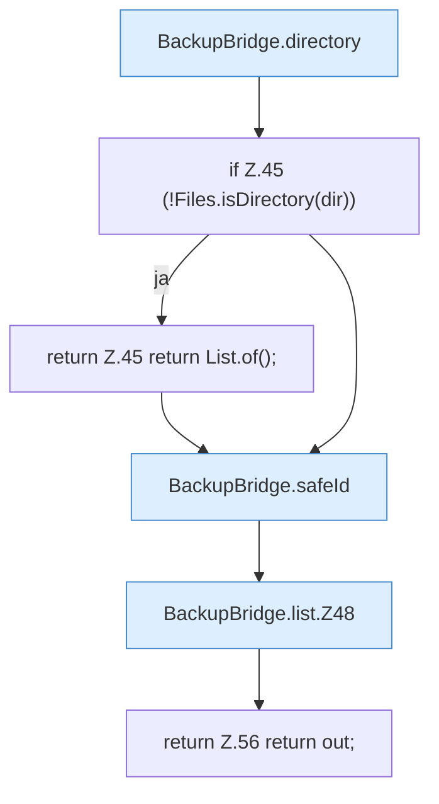

[[00 Start]] › [[Backup]] › [[Backup-Bruecken]] › [[BackupBridge]] › [[BackupBridge.Teil1]] › [[BackupBridge.list]]

# BackupBridge.list

`BackupBridge.list(Spec spec, String serverId)` [src/main/java/de/aichele/childlauncher/BackupBridge.java:43–57](https://github.com/Sciddie/minecraft-serverhoster-plugin/blob/95b02b953b0b4c23673e900e021a7c3c844aa37d/src/main/java/de/aichele/childlauncher/BackupBridge.java#L43-L57)



```knoten
BackupBridge.directory
  `directory` in `BackupBridge.java`.
if Z.45 (!Files.isDirectory(dir))
  Zeile 45: prüft `(!Files.isDirectory(dir))`.
return Z.45 return List.of();
  Zeile 45: Rückgabe `return List.of();`.
BackupBridge.safeId
  Prüft die Pfadgrenze `safeId`.
BackupBridge.list.Z48
  Fortsetzung des Ablaufs ab Zeile 48.
return Z.56 return out;
  Zeile 56: Rückgabe `return out;`.
```

- `list` in `src/main/java/de/aichele/childlauncher/BackupBridge.java`
