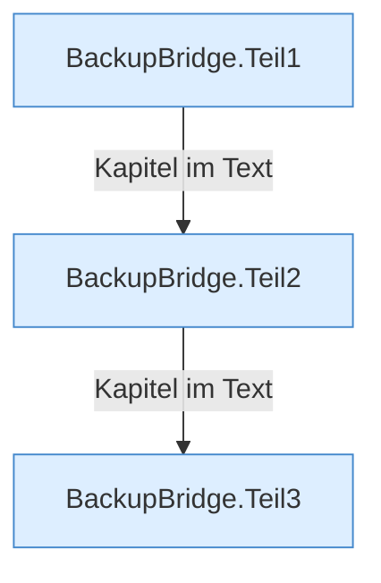

[[00 Start]] › [[Backup]] › [[Backup-Bruecken]] › [[BackupBridge]]

# BackupBridge



```knoten
BackupBridge.Teil1
  Ein weiterer Abschnitt derselben Übersicht. Im [[Glossar#Quelltext|Quelltext]] heißt das `Teil1`.
BackupBridge.Teil2
  Ein weiterer Abschnitt derselben Übersicht. Im [[Glossar#Quelltext|Quelltext]] heißt das `Teil2`.
BackupBridge.Teil3
  Ein weiterer Abschnitt derselben Übersicht. Im [[Glossar#Quelltext|Quelltext]] heißt das `Teil3`.
```

> [!knoten]- Was die Blöcke tun
> - **BackupBridge.Teil1**: Ein weiterer Abschnitt derselben Übersicht. Im [[Glossar#Quelltext|Quelltext]] heißt das `Teil1`.
> - **BackupBridge.Teil2**: Ein weiterer Abschnitt derselben Übersicht. Im [[Glossar#Quelltext|Quelltext]] heißt das `Teil2`.
> - **BackupBridge.Teil3**: Ein weiterer Abschnitt derselben Übersicht. Im [[Glossar#Quelltext|Quelltext]] heißt das `Teil3`.

- Packt die [[Glossar#Sicherungskopie|Sicherungskopie]] auf diesem Rechner und kann sie wieder auspacken.
