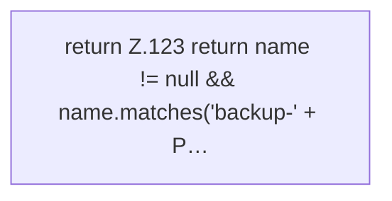

[[00 Start]] › [[Backup]] › [[Backup-Bruecken]] › [[BackupBridge]] › [[BackupBridge.Teil2]] › [[BackupBridge.named]]

# BackupBridge.named

`BackupBridge.named(String safe, String name)` [src/main/java/de/aichele/childlauncher/BackupBridge.java:122–124](https://github.com/Sciddie/minecraft-serverhoster-plugin/blob/95b02b953b0b4c23673e900e021a7c3c844aa37d/src/main/java/de/aichele/childlauncher/BackupBridge.java#L122-L124)

- `named` in `src/main/java/de/aichele/childlauncher/BackupBridge.java`
