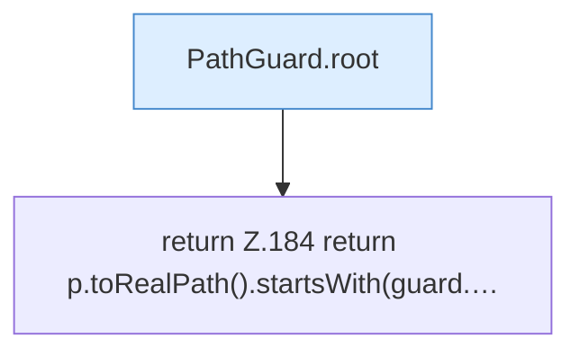

[[00 Start]] › [[Backup]] › [[Backup-Bruecken]] › [[BackupBridge]] › [[BackupBridge.Teil2]] › [[BackupBridge.pRealInside]]

# BackupBridge.pRealInside

`BackupBridge.pRealInside(PathGuard guard, Path p)` [src/main/java/de/aichele/childlauncher/BackupBridge.java:183–185](https://github.com/Sciddie/minecraft-serverhoster-plugin/blob/95b02b953b0b4c23673e900e021a7c3c844aa37d/src/main/java/de/aichele/childlauncher/BackupBridge.java#L183-L185)



```knoten
PathGuard.root
  Dieser Teil macht hier einen einzelnen Schritt. Eine Ebene tiefer steht er genauer. Liefert die Wurzel `root`.
return Z.184 return p.toRealPath().startsWith(guard.…
  Zeile 184: Rückgabe `return p.toRealPath().startsWith(guard.…`.
```

> [!knoten]- Was die Blöcke tun
> - **PathGuard.root**: Dieser Teil macht hier einen einzelnen Schritt. Eine Ebene tiefer steht er genauer. Liefert die Wurzel `root`.
> - **return Z.184 return p.toRealPath().startsWith(guard.…**: Zeile 184: Rückgabe `return p.toRealPath().startsWith(guard.…`.

- Die Sicherung auf diesem Rechner macht hier einen einzelnen Schritt. Eine Ebene tiefer steht er genauer.
- `pRealInside` in `src/main/java/de/aichele/childlauncher/BackupBridge.java`
