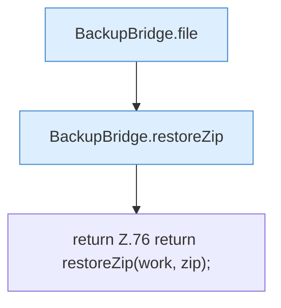

[[00 Start]] › [[Backup]] › [[Backup-Bruecken]] › [[BackupBridge]] › [[BackupBridge.Teil1]] › [[BackupBridge.restore]]

# BackupBridge.restore

`BackupBridge.restore(Path work, Spec spec, String serverId, String name)` [src/main/java/de/aichele/childlauncher/BackupBridge.java:74–77](https://github.com/Sciddie/minecraft-serverhoster-plugin/blob/95b02b953b0b4c23673e900e021a7c3c844aa37d/src/main/java/de/aichele/childlauncher/BackupBridge.java#L74-L77)

- `restore` in `src/main/java/de/aichele/childlauncher/BackupBridge.java`
