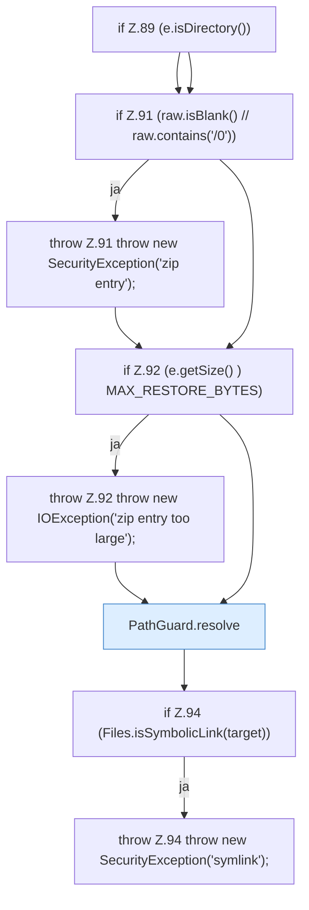

[[00 Start]] › [[Backup]] › [[Backup-Bruecken]] › [[BackupBridge]] › [[BackupBridge.Teil1]] › [[BackupBridge.restoreZip]] › [[BackupBridge.restoreZip.Z84.Z87.Teil1]]

# BackupBridge.restoreZip.Z84.Z87.Teil1



```knoten
if Z.89 (e.isDirectory())
  Zeile 89: prüft `(e.isDirectory())`.
if Z.91 (raw.isBlank() // raw.contains('/0'))
  Zeile 91: prüft `(raw.isBlank() // raw.contains('/0'))`.
throw Z.91 throw new SecurityException('zip entry');
  Zeile 91: Abbruch `throw new SecurityException('zip entry');`.
if Z.92 (e.getSize() ) MAX_RESTORE_BYTES)
  Zeile 92: prüft `(e.getSize() ) MAX_RESTORE_BYTES)`.
throw Z.92 throw new IOException('zip entry too large');
  Zeile 92: Abbruch `throw new IOException('zip entry too large');`.
PathGuard.resolve
  Dieser Teil bestimmt das. Löst auf `resolve`.
if Z.94 (Files.isSymbolicLink(target))
  Zeile 94: prüft `(Files.isSymbolicLink(target))`.
throw Z.94 throw new SecurityException('symlink');
  Zeile 94: Abbruch `throw new SecurityException('symlink');`.
```

> [!knoten]- Was die Blöcke tun
> - **if Z.89 (e.isDirectory())**: Zeile 89: prüft `(e.isDirectory())`.
> - **if Z.91 (raw.isBlank() // raw.contains('/0'))**: Zeile 91: prüft `(raw.isBlank() // raw.contains('/0'))`.
> - **throw Z.91 throw new SecurityException('zip entry');**: Zeile 91: Abbruch `throw new SecurityException('zip entry');`.
> - **if Z.92 (e.getSize() ) MAX_RESTORE_BYTES)**: Zeile 92: prüft `(e.getSize() ) MAX_RESTORE_BYTES)`.
> - **throw Z.92 throw new IOException('zip entry too large');**: Zeile 92: Abbruch `throw new IOException('zip entry too large');`.
> - **PathGuard.resolve**: Dieser Teil bestimmt das. Löst auf `resolve`.
> - **if Z.94 (Files.isSymbolicLink(target))**: Zeile 94: prüft `(Files.isSymbolicLink(target))`.
> - **throw Z.94 throw new SecurityException('symlink');**: Zeile 94: Abbruch `throw new SecurityException('symlink');`.

- Ein weiterer Abschnitt derselben Übersicht.
- Fortsetzung von `BackupBridge.restoreZip.Z84.Z87`.
