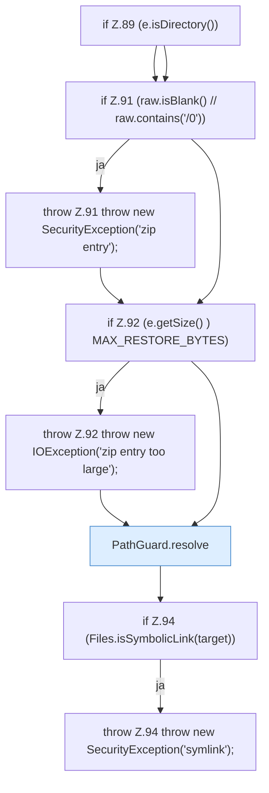

[[00 Start]] › [[Backup]] › [[Backup-Bruecken]] › [[BackupBridge]] › [[BackupBridge.Teil1]] › [[BackupBridge.restoreZip]] › [[BackupBridge.restoreZip.Z84.Z87.Teil1]]

# BackupBridge.restoreZip.Z84.Z87.Teil1

- Fortsetzung von `BackupBridge.restoreZip.Z84.Z87`, Quellreihenfolge.
