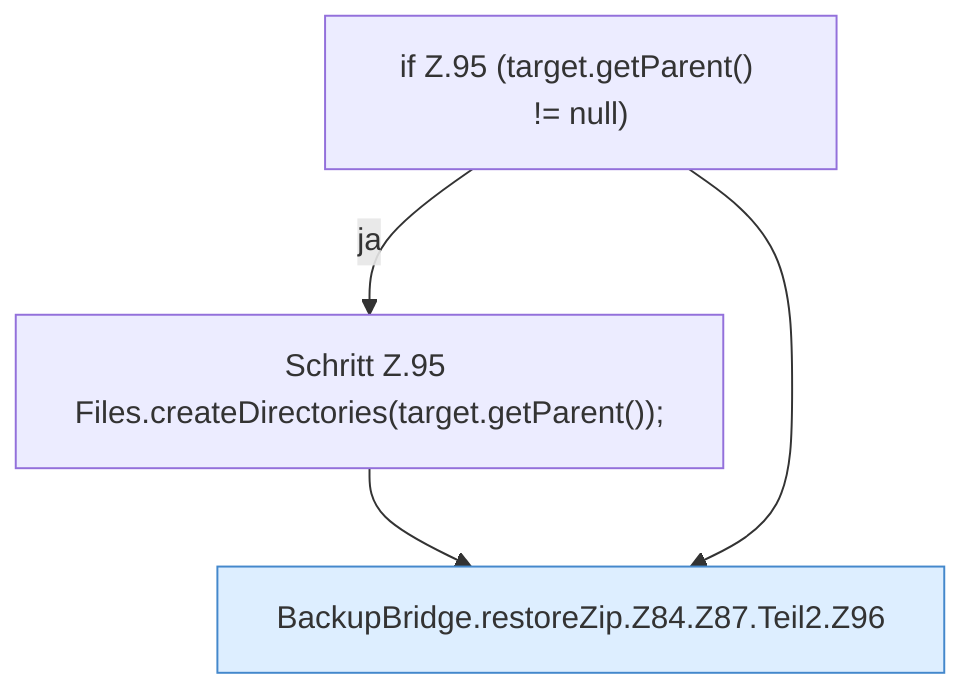

[[00 Start]] › [[Backup]] › [[Backup-Bruecken]] › [[BackupBridge]] › [[BackupBridge.Teil1]] › [[BackupBridge.restoreZip]] › [[BackupBridge.restoreZip.Z84.Z87.Teil2]]

# BackupBridge.restoreZip.Z84.Z87.Teil2



```knoten
if Z.95 (target.getParent() != null)
  Zeile 95: prüft `(target.getParent() != null)`.
Schritt Z.95 Files.createDirectories(target.getParent());
  Zeile 95: Dateioperation. `Files.createDirectories(target.getParent());`
BackupBridge.restoreZip.Z84.Z87.Teil2.Z96
  Der Ablauf geht in [[Glossar#Zeile|Zeile]] 96 weiter. Eine Ebene tiefer steht er genauer. Fortsetzung des Ablaufs ab Zeile 96.
```

> [!knoten]- Was die Blöcke tun
> - **if Z.95 (target.getParent() != null)**: Zeile 95: prüft `(target.getParent() != null)`.
> - **Schritt Z.95 Files.createDirectories(target.getParent());**: Zeile 95: Dateioperation. `Files.createDirectories(target.getParent());`
> - **BackupBridge.restoreZip.Z84.Z87.Teil2.Z96**: Der Ablauf geht in [[Glossar#Zeile|Zeile]] 96 weiter. Eine Ebene tiefer steht er genauer. Fortsetzung des Ablaufs ab Zeile 96.

- Ein weiterer Abschnitt derselben Übersicht.
- Fortsetzung von `BackupBridge.restoreZip.Z84.Z87`.
