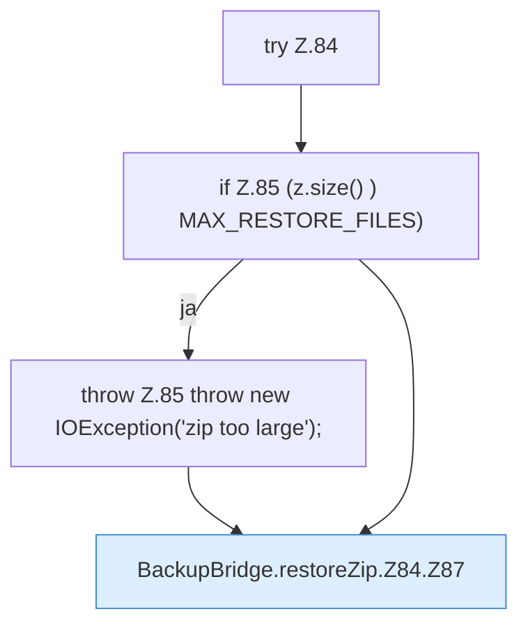

[[00 Start]] › [[Backup]] › [[Backup-Bruecken]] › [[BackupBridge]] › [[BackupBridge.Teil1]] › [[BackupBridge.restoreZip]] › [[BackupBridge.restoreZip.Z84]]

# BackupBridge.restoreZip.Z84



```knoten
try Z.84
  Zeile 84: Versuch. Der Fehlerpfad geht in catch.
if Z.85 (z.size() ) MAX_RESTORE_FILES)
  Zeile 85: prüft `(z.size() ) MAX_RESTORE_FILES)`.
throw Z.85 throw new IOException('zip too large');
  Zeile 85: Abbruch `throw new IOException('zip too large');`.
BackupBridge.restoreZip.Z84.Z87
  Fortsetzung des Ablaufs ab Zeile 87.
```

- Fortsetzung von `BackupBridge.restoreZip`, Quellreihenfolge.
