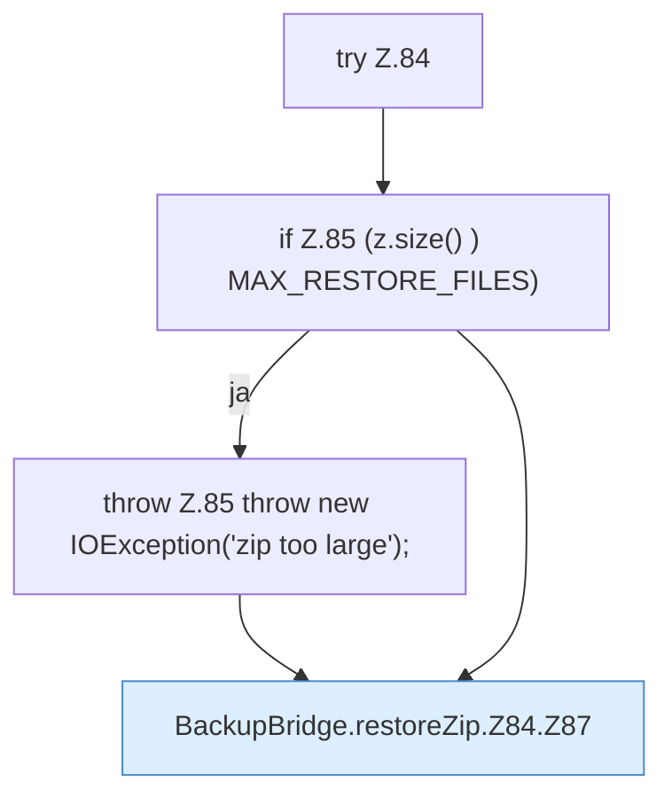

[[00 Start]] › [[Backup]] › [[Backup-Bruecken]] › [[BackupBridge]] › [[BackupBridge.Teil1]] › [[BackupBridge.restoreZip]] › [[BackupBridge.restoreZip.Z84]]

# BackupBridge.restoreZip.Z84

- Fortsetzung von `BackupBridge.restoreZip`, Quellreihenfolge.
