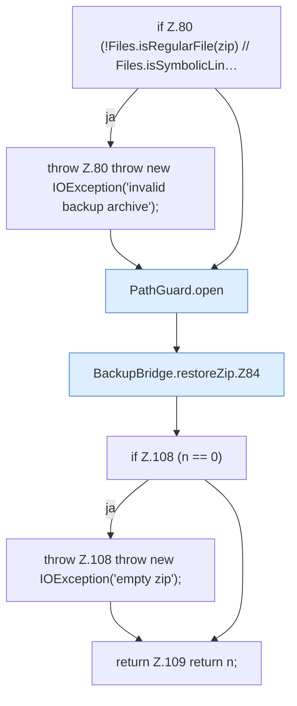

[[00 Start]] › [[Backup]] › [[Backup-Bruecken]] › [[BackupBridge]] › [[BackupBridge.Teil1]] › [[BackupBridge.restoreZip]]

# BackupBridge.restoreZip

`BackupBridge.restoreZip(Path work, Path zip)` [src/main/java/de/aichele/childlauncher/BackupBridge.java:79–110](https://github.com/Sciddie/minecraft-serverhoster-plugin/blob/95b02b953b0b4c23673e900e021a7c3c844aa37d/src/main/java/de/aichele/childlauncher/BackupBridge.java#L79-L110)



```knoten
if Z.80 (!Files.isRegularFile(zip) // Files.isSymbolicLin…
  Zeile 80: prüft `(!Files.isRegularFile(zip) // Files.isSymbolicLin…`.
throw Z.80 throw new IOException('invalid backup archive');
  Zeile 80: Abbruch `throw new IOException('invalid backup archive');`.
PathGuard.open
  Öffnet `open`. Ruft `PathGuard`.
BackupBridge.restoreZip.Z84
  Fortsetzung des Ablaufs ab Zeile 84.
if Z.108 (n == 0)
  Zeile 108: prüft `(n == 0)`.
throw Z.108 throw new IOException('empty zip');
  Zeile 108: Abbruch `throw new IOException('empty zip');`.
return Z.109 return n;
  Zeile 109: Rückgabe `return n;`.
```

- `restoreZip` in `src/main/java/de/aichele/childlauncher/BackupBridge.java`
