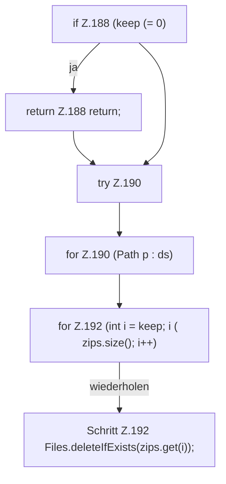

[[00 Start]] › [[Backup]] › [[Backup-Bruecken]] › [[BackupBridge]] › [[BackupBridge.Teil2]] › [[BackupBridge.retain]]

# BackupBridge.retain

`BackupBridge.retain(Path dir, String server, int keep)` [src/main/java/de/aichele/childlauncher/BackupBridge.java:187–193](https://github.com/Sciddie/minecraft-serverhoster-plugin/blob/95b02b953b0b4c23673e900e021a7c3c844aa37d/src/main/java/de/aichele/childlauncher/BackupBridge.java#L187-L193)



```knoten
if Z.188 (keep (= 0)
  Zeile 188: prüft `(keep (= 0)`.
return Z.188 return;
  Zeile 188: Rückgabe `return;`.
try Z.190
  Zeile 190: Versuch. Der Fehlerpfad geht in catch.
for Z.190 (Path p : ds)
  Zeile 190: Schleife `(Path p : ds)`.
for Z.192 (int i = keep; i ( zips.size(); i++)
  Zeile 192: Schleife `(int i = keep; i ( zips.size(); i++)`.
Schritt Z.192 Files.deleteIfExists(zips.get(i));
  Zeile 192: Dateioperation. `Files.deleteIfExists(zips.get(i));`
```

- `retain` in `src/main/java/de/aichele/childlauncher/BackupBridge.java`
