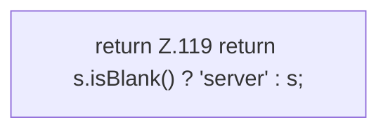

[[00 Start]] › [[Backup]] › [[Backup-Bruecken]] › [[BackupBridge]] › [[BackupBridge.Teil1]] › [[BackupBridge.safeId]]

# BackupBridge.safeId

`BackupBridge.safeId(String serverId)` [src/main/java/de/aichele/childlauncher/BackupBridge.java:117–120](https://github.com/Sciddie/minecraft-serverhoster-plugin/blob/95b02b953b0b4c23673e900e021a7c3c844aa37d/src/main/java/de/aichele/childlauncher/BackupBridge.java#L117-L120)



```knoten
return Z.119 return s.isBlank() ? 'server' : s;
  Zeile 119: Rückgabe `return s.isBlank() ? 'server' : s;`.
```

> [!knoten]- Was die Blöcke tun
> - **return Z.119 return s.isBlank() ? 'server' : s;**: Zeile 119: Rückgabe `return s.isBlank() ? 'server' : s;`.

- Die Sicherung auf diesem Rechner kümmert sich um die Kennung.
- `safeId` in `src/main/java/de/aichele/childlauncher/BackupBridge.java`
