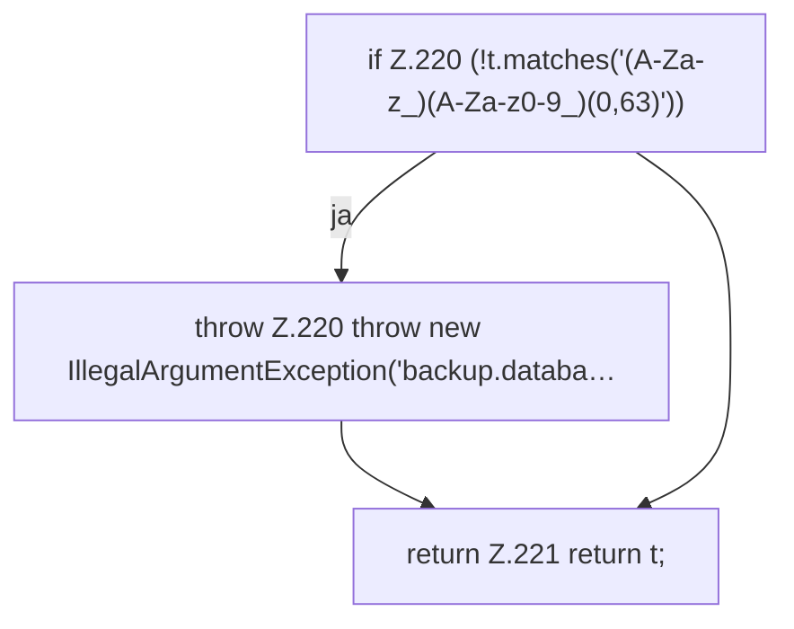

[[00 Start]] › [[Backup]] › [[Backup-Bruecken]] › [[BackupBridge]] › [[BackupBridge.Teil3]] › [[BackupBridge.table]]

# BackupBridge.table

`BackupBridge.table(Spec spec)` [src/main/java/de/aichele/childlauncher/BackupBridge.java:218–222](https://github.com/Sciddie/minecraft-serverhoster-plugin/blob/95b02b953b0b4c23673e900e021a7c3c844aa37d/src/main/java/de/aichele/childlauncher/BackupBridge.java#L218-L222)



```knoten
if Z.220 (!t.matches('(A-Za-z_)(A-Za-z0-9_)(0,63)'))
  Zeile 220: prüft `(!t.matches('(A-Za-z_)(A-Za-z0-9_)(0,63)'))`.
throw Z.220 throw new IllegalArgumentException('backup.databa…
  Zeile 220: Abbruch `throw new IllegalArgumentException('backup.databa…`.
return Z.221 return t;
  Zeile 221: Rückgabe `return t;`.
```

- `table` in `src/main/java/de/aichele/childlauncher/BackupBridge.java`
