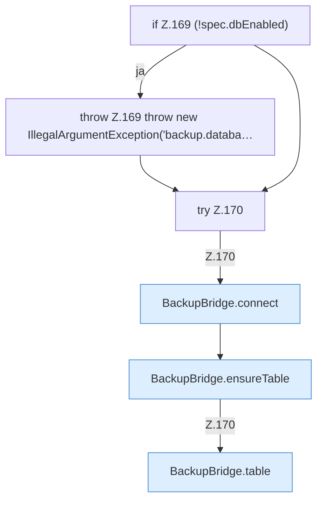

[[00 Start]] › [[Backup]] › [[Backup-Bruecken]] › [[BackupBridge]] › [[BackupBridge.Teil2]] › [[BackupBridge.test]]

# BackupBridge.test

`BackupBridge.test(Spec spec)` [src/main/java/de/aichele/childlauncher/BackupBridge.java:168–171](https://github.com/Sciddie/minecraft-serverhoster-plugin/blob/95b02b953b0b4c23673e900e021a7c3c844aa37d/src/main/java/de/aichele/childlauncher/BackupBridge.java#L168-L171)



```knoten
if Z.169 (!spec.dbEnabled)
  Zeile 169: prüft `(!spec.dbEnabled)`.
throw Z.169 throw new IllegalArgumentException('backup.databa…
  Zeile 169: Abbruch `throw new IllegalArgumentException('backup.databa…`.
try Z.170
  Zeile 170: Versuch. Der Fehlerpfad geht in catch.
BackupBridge.connect
  Die Sicherung auf diesem Rechner macht hier einen einzelnen Schritt. Eine Ebene tiefer steht er genauer. Verbindet `connect`.
BackupBridge.ensureTable
  Die Sicherung auf diesem Rechner macht hier einen einzelnen Schritt. Eine Ebene tiefer steht er genauer. Stellt sicher `ensureTable`.
BackupBridge.table
  Die Sicherung auf diesem Rechner macht hier einen einzelnen Schritt. Eine Ebene tiefer steht er genauer. `table` in `BackupBridge.java`.
```

> [!knoten]- Was die Blöcke tun
> - **if Z.169 (!spec.dbEnabled)**: Zeile 169: prüft `(!spec.dbEnabled)`.
> - **throw Z.169 throw new IllegalArgumentException('backup.databa…**: Zeile 169: Abbruch `throw new IllegalArgumentException('backup.databa…`.
> - **try Z.170**: Zeile 170: Versuch. Der Fehlerpfad geht in catch.
> - **BackupBridge.connect**: Die Sicherung auf diesem Rechner macht hier einen einzelnen Schritt. Eine Ebene tiefer steht er genauer. Verbindet `connect`.
> - **BackupBridge.ensureTable**: Die Sicherung auf diesem Rechner macht hier einen einzelnen Schritt. Eine Ebene tiefer steht er genauer. Stellt sicher `ensureTable`.
> - **BackupBridge.table**: Die Sicherung auf diesem Rechner macht hier einen einzelnen Schritt. Eine Ebene tiefer steht er genauer. `table` in `BackupBridge.java`.

- Die Sicherung auf diesem Rechner prüft das.
- `test` in `src/main/java/de/aichele/childlauncher/BackupBridge.java`
