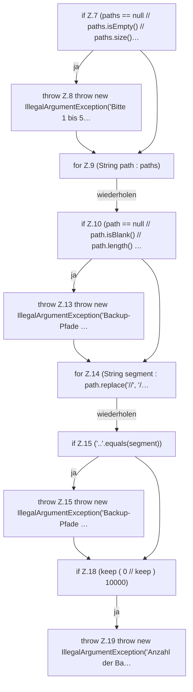

[[00 Start]] › [[Backup]] › [[Backup-Bruecken]] › [[BackupOptions]] › [[BackupOptions.BackupOptions]]

# BackupOptions.BackupOptions

`BackupOptions.BackupOptions()` [src/main/java/de/aichele/childlauncher/BackupOptions.java:6–20](https://github.com/Sciddie/minecraft-serverhoster-plugin/blob/95b02b953b0b4c23673e900e021a7c3c844aa37d/src/main/java/de/aichele/childlauncher/BackupOptions.java#L6-L20)



```knoten
if Z.7 (paths == null // paths.isEmpty() // paths.size()…
  Zeile 7: prüft `(paths == null // paths.isEmpty() // paths.size()…`.
throw Z.8 throw new IllegalArgumentException('Bitte 1 bis 5…
  Zeile 8: Abbruch `throw new IllegalArgumentException('Bitte 1 bis 5…`.
for Z.9 (String path : paths)
  Zeile 9: Schleife `(String path : paths)`.
if Z.10 (path == null // path.isBlank() // path.length() …
  Zeile 10: prüft `(path == null // path.isBlank() // path.length() …`.
throw Z.13 throw new IllegalArgumentException('Backup-Pfade …
  Zeile 13: Abbruch `throw new IllegalArgumentException('Backup-Pfade …`.
for Z.14 (String segment : path.replace('//', '/…
  Zeile 14: Schleife `(String segment : path.replace('//', '/…`.
if Z.15 ('..'.equals(segment))
  Zeile 15: prüft `('..'.equals(segment))`.
throw Z.15 throw new IllegalArgumentException('Backup-Pfade …
  Zeile 15: Abbruch `throw new IllegalArgumentException('Backup-Pfade …`.
if Z.18 (keep ( 0 // keep ) 10000)
  Zeile 18: prüft `(keep ( 0 // keep ) 10000)`.
throw Z.19 throw new IllegalArgumentException('Anzahl der Ba…
  Zeile 19: Abbruch `throw new IllegalArgumentException('Anzahl der Ba…`.
```

- `BackupOptions` in `src/main/java/de/aichele/childlauncher/BackupOptions.java`
