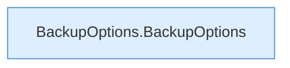

[[00 Start]] › [[Backup]] › [[Backup-Bruecken]] › [[BackupOptions]]

# BackupOptions



```knoten
BackupOptions.BackupOptions
  Dieser Teil sichert die Optionen. Im [[Glossar#Quelltext|Quelltext]] heißt das `BackupOptions`.
```

> [!knoten]- Was die Blöcke tun
> - **BackupOptions.BackupOptions**: Dieser Teil sichert die Optionen. Im [[Glossar#Quelltext|Quelltext]] heißt das `BackupOptions`.

- Die Angaben für einen einzelnen Sicherungslauf, zum Beispiel was mit hineinkommt.
