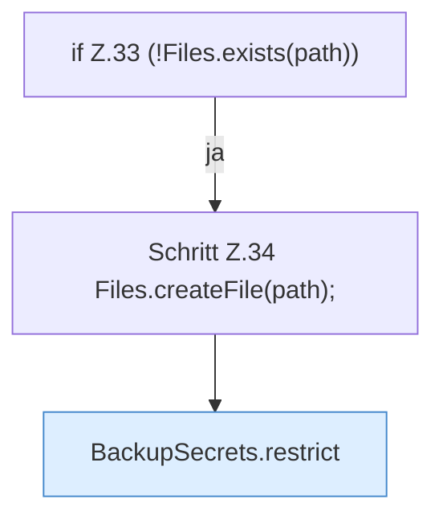

[[00 Start]] › [[Backup]] › [[Backup-Bruecken]] › [[BackupSecrets]] › [[BackupSecrets.load]] › [[BackupSecrets.load.Teil1.Z33]]

# BackupSecrets.load.Teil1.Z33

- Fortsetzung von `BackupSecrets.load.Teil1`, Quellreihenfolge.
