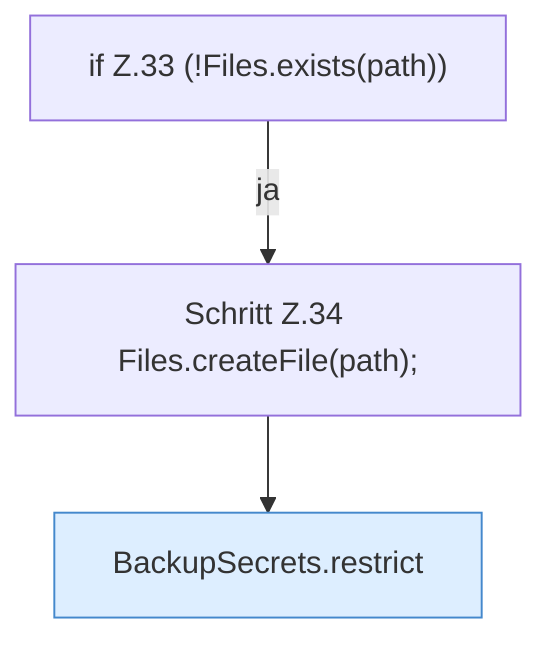

[[00 Start]] › [[Backup]] › [[Backup-Bruecken]] › [[BackupSecrets]] › [[BackupSecrets.load]] › [[BackupSecrets.load.Teil1.Z33]]

# BackupSecrets.load.Teil1.Z33



```knoten
if Z.33 (!Files.exists(path))
  Zeile 33: prüft `(!Files.exists(path))`.
Schritt Z.34 Files.createFile(path);
  Zeile 34: Dateioperation. `Files.createFile(path);`
BackupSecrets.restrict
  Dieser Teil macht hier einen einzelnen Schritt. Eine Ebene tiefer steht er genauer. `restrict` in `BackupSecrets.java`.
```

> [!knoten]- Was die Blöcke tun
> - **if Z.33 (!Files.exists(path))**: Zeile 33: prüft `(!Files.exists(path))`.
> - **Schritt Z.34 Files.createFile(path);**: Zeile 34: Dateioperation. `Files.createFile(path);`
> - **BackupSecrets.restrict**: Dieser Teil macht hier einen einzelnen Schritt. Eine Ebene tiefer steht er genauer. `restrict` in `BackupSecrets.java`.

- Der Ablauf geht in [[Glossar#Zeile|Zeile]] 33 weiter. Eine Ebene tiefer steht er genauer.
- Fortsetzung von `BackupSecrets.load.Teil1`.
