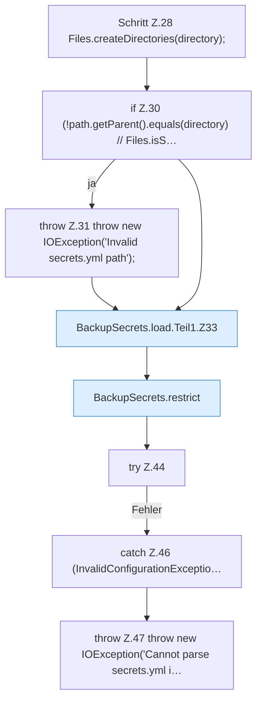

[[00 Start]] › [[Backup]] › [[Backup-Bruecken]] › [[BackupSecrets]] › [[BackupSecrets.load]] › [[BackupSecrets.load.Teil1]]

# BackupSecrets.load.Teil1



```knoten
Schritt Z.28 Files.createDirectories(directory);
  Zeile 28: Dateioperation. `Files.createDirectories(directory);`
if Z.30 (!path.getParent().equals(directory) // Files.isS…
  Zeile 30: prüft `(!path.getParent().equals(directory) // Files.isS…`.
throw Z.31 throw new IOException('Invalid secrets.yml path');
  Zeile 31: Abbruch `throw new IOException('Invalid secrets.yml path');`.
BackupSecrets.load.Teil1.Z33
  Der Ablauf geht in [[Glossar#Zeile|Zeile]] 33 weiter. Eine Ebene tiefer steht er genauer. Fortsetzung des Ablaufs ab Zeile 33.
BackupSecrets.restrict
  Dieser Teil macht hier einen einzelnen Schritt. Eine Ebene tiefer steht er genauer. `restrict` in `BackupSecrets.java`.
try Z.44
  Zeile 44: Versuch. Der Fehlerpfad geht in catch.
catch Z.46 (InvalidConfigurationExceptio…
  Zeile 46: fängt (InvalidConfigurationExceptio….
throw Z.47 throw new IOException('Cannot parse secrets.yml i…
  Zeile 47: Abbruch `throw new IOException('Cannot parse secrets.yml i…`.
```

> [!knoten]- Was die Blöcke tun
> - **Schritt Z.28 Files.createDirectories(directory);**: Zeile 28: Dateioperation. `Files.createDirectories(directory);`
> - **if Z.30 (!path.getParent().equals(directory) // Files.isS…**: Zeile 30: prüft `(!path.getParent().equals(directory) // Files.isS…`.
> - **throw Z.31 throw new IOException('Invalid secrets.yml path');**: Zeile 31: Abbruch `throw new IOException('Invalid secrets.yml path');`.
> - **BackupSecrets.load.Teil1.Z33**: Der Ablauf geht in [[Glossar#Zeile|Zeile]] 33 weiter. Eine Ebene tiefer steht er genauer. Fortsetzung des Ablaufs ab Zeile 33.
> - **BackupSecrets.restrict**: Dieser Teil macht hier einen einzelnen Schritt. Eine Ebene tiefer steht er genauer. `restrict` in `BackupSecrets.java`.
> - **try Z.44**: Zeile 44: Versuch. Der Fehlerpfad geht in catch.
> - **catch Z.46 (InvalidConfigurationExceptio…**: Zeile 46: fängt (InvalidConfigurationExceptio….
> - **throw Z.47 throw new IOException('Cannot parse secrets.yml i…**: Zeile 47: Abbruch `throw new IOException('Cannot parse secrets.yml i…`.

- Ein weiterer Abschnitt derselben Übersicht.
- Fortsetzung von `BackupSecrets.load`.
